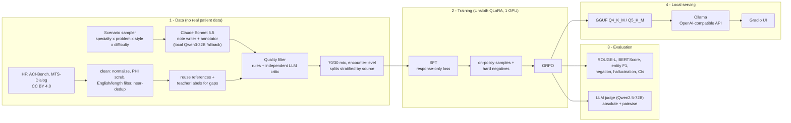

# LocalClinical-Tuner

**Fine-tune an open LLM into a private clinical-documentation assistant that runs 100% on your own hardware.**

Synthetic + public de-identified data → quality-filtered dataset → **Unsloth QLoRA SFT** → **ORPO** preference optimization
→ rigorous evaluation (reference metrics + independent LLM judge) → **GGUF** → **Ollama / OpenAI-compatible API / Gradio**.

[](pyproject.toml)
[](LICENSE)
[](https://huggingface.co/Qwen/Qwen2.5-7B-Instruct)
[](https://github.com/unslothai/unsloth)

> **Not a medical device.** Research/portfolio project. Outputs must be reviewed by a qualified clinician. The
> repository contains **no real patient data**.

---

## Why this project exists

Clinicians spend a large share of their day on documentation: turning a visit into a note, a SOAP structure, and
coded problems/medications. LLMs are good at exactly this kind of text transformation, but the obvious route -
sending encounter text to a hosted frontier model - collides with how clinical data must be handled:

* **HIPAA and data-governance constraints.** Encounter notes are protected health information (PHI). Sending them to a
  third-party API requires a Business Associate Agreement, vendor risk review, data-residency and retention guarantees,
  and audit trails. Many hospitals and clinics simply do not permit it, and de-identification before sending is
  imperfect (names, dates and rare conditions leak).
* **Control and stability.** A hosted model can change, be deprecated, or be rate-limited underneath a clinical
  workflow; you cannot pin weights, inspect them, or validate a frozen version.
* **Cost and latency at the point of care.** Per-token pricing for every note, plus network round-trips, adds up.

**The fix is to bring the model to the data.** A 7-8B open model, specialized for the narrow task with parameter-
efficient fine-tuning and quantized to ~4.5 GB, runs on a single workstation GPU or a laptop, keeps PHI on premises,
can be versioned and validated like any other software artifact - and, on the narrow task it was trained for, it
improves substantially over its general-purpose starting point (see [Results](#results)).

Where hosted models *are* used here - generating the synthetic training notes - they only ever see **fictional
scenarios**, never patient data. At inference time nothing leaves the machine.

## Highlights

| Stage | What it does |
|---|---|
| **Data** | 1,000 encounters × 3 tasks = 3,000 instruction examples in the reference run (scales via `data.composition.total_encounters`). **70% synthetic** notes written by Claude (via the API, or via prompt batches run in the Claude app / Claude Code - no API key needed; the reference run used the batch route) from 164 presenting problems across 20 specialties × 8 note styles × 3 difficulty levels; **30% public CC BY 4.0** doctor-patient dialogues (ACI-Bench, MTS-Dialog), license-checked, PHI-scrubbed, English/length-filtered and near-deduplicated against the synthetic set. Existing human references are reused where they fit a task. |
| **Quality filter** | Runs on both sources: rule-based clinical sanity checks (vital/lab plausibility, drug max-dose table, age/sex consistency, allergy-vs-prescription conflicts, SOAP completeness, entity grounding, hallucinated medications, negation consistency) **+ an LLM critic that is always a different model from the record's generator** (JSON rubric, severity-tagged errors). Random accepted/rejected samples are exported for human review; a [data card](data/DATA_CARD.md) records sources, licenses and rejection statistics. |
| **SFT** | Unsloth + QLoRA (4-bit NF4 base, LoRA r=32 on all attention/MLP projections, optional DoRA), loss on assistant tokens only (verified by an automatic label-mask check). |
| **Preference optimization** | **ORPO** (reference-free odds-ratio preference loss; DPO selectable) on pairs mined from the SFT model's *own* failures on a held-out split, plus targeted hard negatives (hallucinated medication, flipped negation, dropped plan, wrong SOAP section). NLL term on response tokens only (fixes TRL's prompt+response default); λ chosen on the validation split. |
| **Evaluation** | ROUGE-L, BERTScore, entity-level F1 (strict + relaxed), negation accuracy, SOAP structure, JSON validity, medication-hallucination rate, key-entity coverage - with bootstrap 95% CIs, per task and per data source; **LLM-as-a-judge** (Qwen2.5-72B, which generated none of the training data) with absolute rubric scores and position-debiased pairwise comparisons. |
| **Serving** | GGUF Q4_K_M + Q5_K_M via llama.cpp, an Ollama Modelfile whose prompt format is verified token-for-token against training, an OpenAI-compatible endpoint, a Gradio UI with entity highlighting, and a one-command demo. |

## Results

<!-- RESULTS:START -->
**Headline (base → SFT → SFT+ORPO):** entity F1 0.630 → 0.829 → 0.829; SOAP ROUGE-L 0.583 → 0.749 → 0.752; summary ROUGE-L 0.383 → 0.558 → 0.548; LLM-judge pairwise win/tie/loss %: SFT+ORPO vs base 21/45/34; SFT+ORPO vs SFT 5/74/21; SFT vs base 25/41/33.

Dataset: 1,000 encounters / 3,000 examples (70% synthetic).

<picture>
  <source media="(prefers-color-scheme: dark)" srcset="results/figures/key_metrics_dark.png">
  
</picture>

Full per-source breakdown: [results/comparison_table.md](results/comparison_table.md); raw numbers: [results/metrics.json](results/metrics.json); side-by-side generations: [results/sample_outputs.md](results/sample_outputs.md).


Test set: **300 examples** from 100 held-out encounters (sources: aci-bench, mts-dialog, synthetic). Greedy decoding with identical settings for every model ({'temperature': 0.0, 'max_tokens': 1536, 'repetition_penalty': 1.05}). Values are means with bootstrap 95% CI over test examples (1000 resamples) in parentheses.

#### Main comparison

| Metric | Base (Qwen2.5-7B-Instruct) | SFT | SFT + ORPO | SFT + ORPO (Q4_K_M GGUF) |
|---|---|---|---|---|
| Summary ROUGE-L ↑ | 0.383 (0.368-0.399) | **0.558 (0.535-0.580)** | 0.548 (0.522-0.573) | 0.544 (0.519-0.568) |
| Summary BERTScore F1 ↑ | 0.411 (0.392-0.430) | **0.569 (0.547-0.590)** | 0.567 (0.545-0.588) | 0.559 (0.535-0.582) |
| Summary key-entity coverage ↑ | 67.0% (61.4-72.8) | 77.2% (72.6-81.5) | 75.1% (70.5-79.7) | **79.5% (75.1-83.5)** |
| Summary length compliance ↑ | 98.0% (95.0-100.0) | **99.0% (97.0-100.0)** | **99.0% (97.0-100.0)** | 98.0% (95.0-100.0) |
| Summary medication hallucination ↓ | **0.0% (0.0-0.0)** | **0.0% (0.0-0.0)** | **0.0% (0.0-0.0)** | **0.0% (0.0-0.0)** |
| SOAP ROUGE-L ↑ | 0.583 (0.553-0.611) | 0.749 (0.718-0.776) | **0.752 (0.721-0.778)** | 0.747 (0.716-0.772) |
| SOAP BERTScore F1 ↑ | 0.471 (0.454-0.489) | 0.736 (0.701-0.765) | **0.748 (0.727-0.769)** | 0.737 (0.716-0.758) |
| SOAP structure adherence ↑ | 99.2% (97.8-100.0) | **100.0% (100.0-100.0)** | **100.0% (100.0-100.0)** | **100.0% (100.0-100.0)** |
| SOAP key-entity coverage ↑ | 94.6% (91.8-97.0) | 95.4% (92.7-97.9) | 96.3% (93.6-98.4) | **97.1% (95.1-98.9)** |
| SOAP medication hallucination ↓ | **0.0% (0.0-0.0)** | **0.0% (0.0-0.0)** | **0.0% (0.0-0.0)** | **0.0% (0.0-0.0)** |
| Entity F1 (relaxed) ↑ | 0.630 (0.600-0.659) | **0.829 (0.803-0.849)** | 0.829 (0.803-0.849) | 0.816 (0.790-0.838) |
| Entity F1 (strict) ↑ | 0.544 (0.507-0.579) | **0.798 (0.771-0.819)** | 0.796 (0.769-0.819) | 0.774 (0.744-0.800) |
| Symptom negation accuracy ↑ | 97.6% | **100.0%** | **100.0%** | 99.9% |
| Valid JSON ↑ | **100.0% (100.0-100.0)** | **100.0% (100.0-100.0)** | **100.0% (100.0-100.0)** | **100.0% (100.0-100.0)** |

#### LLM-as-a-judge (judge: `Qwen/Qwen2.5-72B-Instruct`, reference-free, 1-5)

| Dimension | Base (Qwen2.5-7B-Instruct) | SFT | SFT + ORPO |
|---|---|---|---|
| faithfulness | 4.480 (4.360-4.593) | 4.720 (4.627-4.807) | 4.500 (4.370-4.637) |
| completeness | 4.307 (4.180-4.433) | 4.493 (4.360-4.620) | 4.308 (4.164-4.452) |
| format | 4.927 (4.873-4.973) | 4.933 (4.860-4.987) | 4.829 (4.733-4.918) |
| clinical_usefulness | 4.487 (4.380-4.587) | 4.607 (4.473-4.720) | 4.418 (4.274-4.569) |
| overall | 4.373 (4.267-4.473) | 4.573 (4.467-4.673) | 4.384 (4.260-4.507) |

**Pairwise (each comparison judged in both presentation orders; disagreement counts as a tie)**

| Comparison | n | win | tie | loss | position consistency |
|---|---|---|---|---|---|
| SFT + ORPO vs Base (Qwen2.5-7B-Instruct) | 150 | 20.7% | 45.3% | 34.0% | 56.0% |
| SFT + ORPO vs SFT | 150 | 4.7% | 74.0% | 21.3% | 50.0% |
| SFT vs Base (Qwen2.5-7B-Instruct) | 150 | 25.3% | 41.3% | 33.3% | 60.0% |

Pairwise by task (win / tie / loss, %):

| Comparison | summary | soap | entities |
|---|---|---|---|
| SFT + ORPO vs Base (Qwen2.5-7B-Instruct) | 22 / 54 / 24 | 12 / 48 / 40 | 28 / 34 / 38 |
| SFT + ORPO vs SFT | 8 / 74 / 18 | 2 / 76 / 22 | 4 / 72 / 24 |
| SFT vs Base (Qwen2.5-7B-Instruct) | 30 / 50 / 20 | 10 / 40 / 50 | 36 / 34 / 30 |
<!-- RESULTS:END -->

### Model selection for the preference stage (validation split)

<!-- SELECTION:START -->
Validation split: 75 examples from 25 encounters (never used for training or for test reporting). Judge: pairwise against SFT, both presentation orders.

| Model | Summary ROUGE-L | SOAP ROUGE-L | Entity F1 (relaxed) | Negation acc. | Judge overall (1-5) | vs SFT win / tie / loss |
|---|---|---|---|---|---|---|
| SFT | 0.547 | 0.760 | 0.858 | 1.000 | 4.44 | - |
| SFT + ORPO λ=0.1 | 0.549 | 0.766 | 0.875 | 1.000 | 4.62 | 15% / 77% / 8% |
| SFT + ORPO λ=0.5 | 0.535 | 0.755 | 0.878 | 1.000 | 4.56 | 12% / 77% / 11% |
| SFT + ORPO λ=0.1, TRL's NLL over prompt + response | 0.534 | 0.730 | 0.848 | 1.000 | 4.51 | 12% / 68% / 20% |
<!-- SELECTION:END -->

### Reading the results

* **SFT does the heavy lifting.** ROUGE-L, BERTScore and entity F1 all improve over the base model with
  non-overlapping 95% CIs (entity F1 0.630 → 0.829, SOAP ROUGE-L 0.583 → 0.749, summary ROUGE-L 0.383 → 0.558),
  symptom-negation accuracy reaches 100%, and the judge's absolute scores rise most on faithfulness (4.48 → 4.72).
* **Head-to-head, the judge often prefers the base model's SOAP notes.** Base SOAP notes are longer (266 vs 211 words
  on average) and split SUBJECTIVE into labelled sub-sections (chief complaint, HPI, pertinent negatives), which the
  judge rewards as "more structured and complete"; the fine-tuned models write the prose sections of the training
  references. That is where the base model's pairwise wins come from (SOAP: base preferred 50% vs 10%), together with
  the short public-dialogue excerpts. On summaries and entity extraction the fine-tuned model is preferred (SFT vs
  base, win/tie/loss: 30/50/20 and 36/34/30). Sub-labelled SOAP notes are a change to the reference style of the
  training data, not to the method.
* **The preference stage adds no reliable gain here - after fixing a loss bug.** With TRL's default ORPO loss (NLL over
  prompt + response, see [Design decisions](#design-decisions)), SFT+ORPO was worse than SFT on every metric (test
  SOAP ROUGE-L 0.732 vs 0.749, entity F1 0.817 vs 0.829, judge win/tie/loss vs SFT 9/57/34). With the NLL on the
  response only, ORPO matches SFT on every reference metric; the judge preferred it on validation (15% vs 8% wins)
  but preferred SFT on test (5% vs 21%), with three quarters of comparisons tied. The likely reason: the pairs target
  mistakes the SFT model rarely makes (it already has 100% negation accuracy and no hallucinated medications), and
  chosen and rejected answers often differ in a handful of tokens, so the length-normalised odds ratio barely moves
  (held-out preference accuracy 0.54). The exported model is SFT+ORPO because it was selected on validation before the
  test set was scored; the SFT model is equivalent on reference metrics and can be exported instead with
  `uv run python serving/export_gguf.py --merged outputs/sft/merged`.
* **Treat small judge differences as noise.** On 28 test items SFT and SFT+ORPO produced byte-identical outputs, yet the
  judge (temperature 0, FP8) gave 5 of those pairs different absolute scores, and pairwise verdicts agree across the
  two presentation orders only 50-60% of the time. Differences below ~0.2 points (absolute) or ~10 points (pairwise)
  are within that noise.
* **Quantization is nearly free.** The Q4_K_M GGUF stays inside the 95% CIs of its 16-bit source on every metric
  (largest drop: strict entity F1 0.796 → 0.774).
* **Medication hallucination is 0% for every model, including the base model.** These test notes do not provoke it,
  so here the metric acts as a guardrail rather than a discriminator.

## Data quality: how the dataset was built and checked

<!-- DATA:START -->
Final dataset: **1,000 encounters -> 3,000 instruction examples**, 70% synthetic, split by encounter (train/val/pref/test = {'test': 100, 'val': 25, 'pref': 150, 'train': 725}).

| Source | Candidates | Rejected by rules | Rejected by critic | Accepted | Used (70/30 mix) |
|---|---|---|---|---|---|
| synthetic | 750 | 2 | 16 | 732 | 700 |
| mts-dialog | 625 | 243 | 115 | 267 | 255 |
| aci-bench | 181 | 58 | 76 | 47 | 45 |

* Critic `Qwen/Qwen3-32B` canary: 83% of 60 injected errors caught, 0% of 60 clean records rejected.
* Critic `Qwen/Qwen2.5-72B-Instruct` canary: 82% of 38 injected errors caught, 10% of 38 clean records rejected.
* `scripts/validate_dataset.py`: **PASSED** (0 errors) - no encounter or near-duplicate note shared between test and training, prompts byte-identical to the serving prompt builder, all gold entities grounded in their notes, no identifier patterns.
* Full details: [data/DATA_CARD.md](data/DATA_CARD.md); human-review sample: [data/review/review_sample.md](data/review/review_sample.md).
<!-- DATA:END -->

**Validating the validator.** A critic that rubber-stamps data is worse than none, so the pipeline measures it:
`scripts/critic_canary.py` takes records the critic accepted, injects four clinically dangerous label errors
(a hallucinated medication in the summary, a hallucinated plan item, a flipped symptom negation, a wiped
assessment) and re-runs the critic on corrupted and clean copies. On this project's data the first critic
prompt caught only **45%** of injected errors - it found hallucinated drugs but **none** of the negation flips or
dropped diagnoses. The fixes, each re-measured:

| Critic version | Change | Injected errors caught | Clean records wrongly rejected |
|---|---|---|---|
| v1 | rubric + scores | 45% | 0% |
| v2 | mandatory `checks` lists (unsupported statements, negation flags, omissions) that are binding | 100% | 52.5% (self-contradicting negation claims) |
| v3 | entities shown as "Symptoms PRESENT / ABSENT" instead of JSON `negated` booleans | 100% | 15% |
| v4 | each claimed negation error re-verified with a focused yes/no question | 100% (held-out n=60) | 0% (held-out n=60) |
| **v5 (used)** | claimed unsupported statements also re-verified; omissions binding only from 3 findings | Qwen3-32B: 83% / Qwen2.5-72B: 82% | Qwen3-32B: 0% / Qwen2.5-72B: 10.5% |

v5 trades some sensitivity to *omissions* (a wiped assessment is caught by the critic 47% of the time) for far fewer
false rejections of short public dialogue snippets that genuinely have no assessment. For synthetic encounters the
rule engine closes that gap: a missing assessment or plan on a full encounter is a critical rule finding, so the
combined filter still rejects it. Hallucinated medications are caught by the critic in 89-100% of cases and by the rule engine whenever the drug is in its curated list (all canary drugs were).

The rule engine got the same treatment: every false positive found while generating data (a heart rate read out of
"SpO2", "radial pulse 2+" read as a heart rate, "allergic rhinitis" read as a drug allergy, "HCQ" not recognized
as hydroxychloroquine, spoken dates such as "June thirty two thousand and four" escaping PHI scrubbing) became a
regression test in `tests/`.

## Architecture



Every model call in the pipeline goes through one small client abstraction (`src/clinical_tuner/llm.py`) that speaks
either the Anthropic API (synthetic-data generation only) or any OpenAI-compatible server (vLLM, Ollama, llama.cpp).
Prompts the *student* sees are defined once in `src/clinical_tuner/prompts.py` and reused by training, evaluation,
the Gradio app and the generated Ollama Modelfile, so train/serve skew is impossible by construction.

## Tasks

All three tasks share one system prompt and take the same note as input:

| Task | Output | Main metrics |
|---|---|---|
| **Summary** | 3-6 sentences, ≤120 words, plain prose | ROUGE-L, BERTScore, key-entity coverage, length compliance, medication hallucination |
| **SOAP note** | `SUBJECTIVE:` / `OBJECTIVE:` / `ASSESSMENT:` / `PLAN:` (numbered) | ROUGE-L, BERTScore, structure adherence, key-entity coverage, medication hallucination |
| **Entity extraction** | JSON: `symptoms` (with `negated`), `diagnoses`, `medications` (`name`/`dose`/`frequency`), `procedures` | entity F1 (strict + relaxed), negation accuracy, JSON validity |

## Quickstart: run the demo

With a trained/exported model (or a GGUF you downloaded) and [Ollama](https://ollama.com/download) installed:

```bash
uv sync --extra serve
```

```bash
bash scripts/run_demo.sh
```

This starts Ollama on `127.0.0.1:11434` (if it isn't running), registers `serving/ollama_modelfile` as model
`localclinical`, and opens the Gradio UI at http://127.0.0.1:7860. The same model is available to any OpenAI client:

```bash
curl http://127.0.0.1:11434/v1/chat/completions -H "Content-Type: application/json" -d '{"model": "localclinical", "temperature": 0, "messages": [{"role": "user", "content": "Summarize the following clinical encounter note for a busy clinician. ... Clinical note: \"\"\"Pt is a 54yo M c/o ...\"\"\""}]}'
```

For best quality send the exact task instructions from `src/clinical_tuner/prompts.py` (`build_messages(task, note)`
does it for you); the Modelfile already contains the training system prompt. llama.cpp's own server works too:
`llama-server -m outputs/gguf/localclinical-q4_k_m.gguf --port 8080` exposes `/v1/chat/completions` with the GGUF's
embedded chat template.

## Reproduce everything

### Hardware

<!-- HARDWARE:START -->
Measured on this project's reference run (one GPU per training stage):

| Stage | GPU | Peak VRAM (reserved) | Wall time | Workload |
|---|---|---|---|---|
| SFT | NVIDIA RTX A6000 | 13.7 GB | 39 min | 2,175 examples, 272 steps |
| ORPO | NVIDIA RTX A6000 | 18.52 GB | 16 min | 426 pairs, 54 steps |

GGUF sizes: Q4_K_M 4.36 GB, Q5_K_M 5.07 GB.

* **Training** peaked at 18.5 GB (reserved by PyTorch, measured on the GPU above), inside the budget of a single **24 GB** card (RTX 3090/4090/A5000) with the default settings. On 16 GB, use `--set sft.per_device_batch_size=1 --set sft.gradient_accumulation_steps=16` (same effective batch) for SFT.
* **Inference** of the Q4_K_M GGUF needs ~6 GB of GPU memory (or runs on CPU / Apple Silicon via Ollama).
* **Data generation and judging** use larger local models: the Qwen3-32B teacher/critic and the Qwen2.5-72B judge run in FP8 on 2×48 GB GPUs. With less hardware, point the `teacher`/`judge` endpoints at smaller models (e.g. Qwen3-14B) - the pipeline only needs OpenAI-compatible URLs.
<!-- HARDWARE:END -->

### Software setup

```bash
git clone <your-fork-url> LocalClinical-Tuner && cd LocalClinical-Tuner
```

```bash
uv sync --all-extras
```

[uv](https://docs.astral.sh/uv/) installs a locked environment (`uv.lock`) with Unsloth, TRL, PEFT, bitsandbytes,
BERTScore and Gradio. **vLLM runs as a separate process in its own environment** (its pinned torch/transformers
versions conflict with the training stack); point `VLLM_BIN` at it, e.g. `uv tool install vllm` and
`VLLM_BIN=vllm`, or an existing venv such as `VLLM_BIN=~/vllm-env/bin/vllm`.

### Where the synthetic 70% comes from - pick one

| Option | What you need | Command |
|---|---|---|
| **A. Anthropic API** | `ANTHROPIC_API_KEY` | `DATA_SOURCE=api` (default) |
| **B. Bring your own data** - e.g. generated in the Claude desktop/web app | a Claude subscription, or any notes you have | `DATA_SOURCE=external` |
| **C. Fully local** | nothing extra | `DATA_SOURCE=local` |

**A. API key.** Put the key in a gitignored `.env` (it is only used to *generate synthetic data*):

```bash
echo "ANTHROPIC_API_KEY=sk-ant-..." > .env
```

**B. Claude app (no API key).** `data/make_external_batches.py` turns the same seeded scenario sampler into copy-paste
prompts (already generated in `data/external/claude_app/`):

1. In the Claude app, create a **Project** and paste `data/external/claude_app/INSTRUCTIONS.md` into its custom
   instructions (or upload it as a project file and tell Claude to follow it).
2. For each `data/external/claude_app/batches/batch_NNN.md`, open a **new chat** in that Project, paste the file, and
   save the reply's ```` ```jsonl ```` block as `data/external/claude_app/responses/batch_NNN.jsonl`
   (15 encounters per batch; if a reply stops early, say "continue" and paste both parts into the same file).
3. Import and validate - this reports missing ids and can write a make-up batch for them:

```bash
uv run python data/import_external_notes.py --generator-label "claude-opus-5-5 (Claude app)" --write-missing-batch
```

60 batches (~900 notes) already yield > 3,000 instruction examples after filtering; all 117 batches (~1,750 notes)
reproduce the full-size dataset. Any other source works the same way: put JSONL files with at least a `"note"` field
(optionally `summary`/`soap`/`entities`) in a folder and pass `--inputs`. For **real or sensitive notes** add
`--private`: identifiers are scrubbed instead of rejected, missing labels come only from the local teacher, and the
quality filter never sends those records to a remote model.

> **How this repository's reference run was produced:** without an API key, the synthetic notes were generated
> with option B - Claude Sonnet 5.5 sub-agents in Claude Code executed `batches/batch_001..050.md` and wrote the
> replies straight to `responses/`, each batch passing `data/validate_batch.py` (format, ids, verbatim entities,
> summary length and the full clinical rule set) before acceptance. 50 of 117 batches (750 notes) were generated
> within the session's usage budget, which sets the reference run at 1,000 encounters (700 synthetic + 300 public).
> Running all 117 batches (1,755 scenarios) and raising `data.composition.total_encounters` to 2,000 gives the
> larger configuration (6,000 examples) with the same 70/30 mix.

**C. Fully local.** `DATA_SOURCE=local` writes the synthetic notes with the local Qwen3-32B teacher; the critic for
those records is then Qwen2.5-72B.

> Whichever model writes your synthetic data, check its provider's terms on using outputs to train models. The local
> Qwen3-32B (Apache-2.0) path has no such restriction.

### One command

```bash
DATA_SOURCE=external GPUS=0,1 TRAIN_GPU=0 SERVE_GPU=1 VLLM_BIN=vllm bash scripts/run_full_pipeline.sh
```

Stages are idempotent (finished ones are skipped; `FORCE=1` re-runs; `STAGES="orpo eval"` runs a subset), vLLM servers
are started and stopped automatically on the GPUs you name, and the script refuses to start on GPUs that other
processes are already using.

### Step by step

```bash
# 1. Data: synthetic + public dialogues -> quality filter -> 70/30 splits (+ data/DATA_CARD.md)
scripts/vllm_server.sh start teacher Qwen/Qwen3-32B 8100 0,1 --quantization fp8 --max-model-len 8192
scripts/vllm_server.sh wait 8100
uv run python data/generate_synthetic_notes.py            # option A (or: data/import_external_notes.py for B)
uv run python data/ingest_hf_datasets.py
uv run python data/quality_filter.py --cache-only         # critic pass 1: Qwen3-32B
scripts/vllm_server.sh stop teacher
scripts/vllm_server.sh start judge Qwen/Qwen2.5-72B-Instruct 8200 0,1 --quantization fp8 --max-model-len 12288
scripts/vllm_server.sh wait 8200
uv run python data/quality_filter.py                      # critic pass 2: Qwen2.5-72B for teacher-labelled records
scripts/vllm_server.sh stop judge
uv run python scripts/prepare_dataset.py

# 2. Stage-1 SFT (Unsloth QLoRA)
CUDA_VISIBLE_DEVICES=0 uv run python training/sft_train.py

# 3. Preference pairs from the SFT model's own failures, then Stage-2 ORPO
scripts/vllm_server.sh start sft outputs/sft/merged 8301 1 --max-model-len 8192 && scripts/vllm_server.sh wait 8301
uv run python scripts/build_preference_data.py
CUDA_VISIBLE_DEVICES=0 uv run python training/orpo_train.py
#    (optional) choose ORPO's lambda on the validation split - trains candidates, judges each against SFT:
#    GPUS=0,1 LAMBDAS="0.1 0.5" bash scripts/tune_orpo.sh

# 4. Evaluate (repeat `generate` for base / sft / orpo with the matching server running), judge, report
uv run python training/evaluate.py generate --model orpo
uv run python training/evaluate.py score
uv run python training/evaluate.py judge      # needs the judge server (Qwen2.5-72B FP8) on port 8200
uv run python training/evaluate.py report

# 5. Export GGUF (Q4_K_M + Q5_K_M) and the Ollama Modelfile
uv run python serving/export_gguf.py
```

Every script reads `training/config.yaml` and accepts `--set key.path=value` overrides, e.g.
`--set sft.epochs=1 --set lora.use_dora=true --set orpo.method=dpo`. Unknown keys fail loudly.

## Design decisions

* **Qwen2.5-7B-Instruct over Llama-3.1-8B-Instruct.** Apache-2.0 license (Llama 3.1 uses a custom community license),
  strong instruction/JSON following and medical knowledge for its size, and a ChatML template that makes response-only
  loss masking unambiguous. Llama-3.1-8B is supported by changing `model.base_model` (chat markers are auto-detected).
* **QLoRA with Unsloth.** 4-bit NF4 base + LoRA on every projection fits a 7B model and 4K-token sequences on a single
  consumer GPU; Unsloth's fused kernels and padding-free batching cut time and memory further. DoRA is one flag
  (`lora.use_dora`), off by default because it trains slower and vLLM cannot serve unmerged DoRA adapters.
* **SFT → ORPO, not PPO.** ORPO adds an odds-ratio penalty to the chosen answer's NLL: no reward model, no reference
  model, no RL loop. Preference pairs are mined *on-policy* - the SFT model's worst sample per prompt, scored against
  the gold answer - so the second stage targets mistakes this model actually makes; when the SFT model is already good
  on a prompt, a targeted clinical hard negative is used instead.
* **ORPO's NLL term on the response, not the prompt.** TRL's `ORPOTrainer` computes the NLL part of the ORPO loss
  over prompt + response. Here the prompt is a clinical note several hundred tokens long, so most of that term
  trained the model to reproduce its *input*: at step 0 TRL's NLL was 2.0-2.5 while the NLL of the responses alone
  was 0.04-0.65. `orpo_train.py` computes the NLL on response tokens only - the paper's -log P(y_w|x), and the same
  objective as the SFT stage - from the same log-softmax pass the odds-ratio term already uses (bit-identical
  log-probabilities; it also avoids TRL's extra full-vocabulary cross-entropy). `orpo.nll_on_prompt: true` restores
  TRL's behavior.
* **Hyperparameters are selected on the validation split, never on test.** `scripts/tune_orpo.sh` trains ORPO
  candidates, then compares them with SFT on validation outputs (reference metrics + pairwise LLM judge); the test
  set is generated and scored once, for the selected configuration.
* **Two-call generation.** The teacher writes the note, then labels it in a fresh context that sees only the note, so
  labels cannot leak scenario details that are not in the text. Entity labels must be verbatim spans and are
  re-grounded programmatically.
* **Independent critic and judge.** Claude-generated records are criticized by Qwen3-32B; anything Qwen3-32B
  generated is criticized by another model. The evaluation judge (Qwen2.5-72B) generated no training data at all,
  avoiding self-preference bias; it shares a model family with the *base* model, which, if anything, biases it
  against the fine-tuned model.
* **Encounter-level, source-stratified splits.** The three task examples of a note always land in the same split, so
  the test set never contains a note seen in training; per-source metrics show whether gains hold on public
  dialogues as well as on the synthetic distribution.
* **Fair baseline.** All models get identical prompts and greedy decoding; entity outputs are parsed leniently (code
  fences, key casing, strings vs objects) so the base model is not penalized for harmless format variation.

## Project structure

```text
LocalClinical-Tuner/
├── data/
│   ├── generate_synthetic_notes.py   # synthetic encounters with Claude API (local fallback), two-call note + labels
│   ├── make_external_batches.py      # copy-paste prompt batches for the Claude app (no API key)
│   ├── import_external_notes.py      # bring-your-own data / Claude-app replies -> validated records
│   ├── validate_batch.py             # per-batch validator for Claude-app replies (grounding, doses, PHI, ...)
│   ├── external/claude_app/          # INSTRUCTIONS.md, batches/, responses/
│   ├── ingest_hf_datasets.py         # ACI-Bench + MTS-Dialog: license-checked, cleaned, deduped, labeled
│   ├── quality_filter.py             # rules + independent LLM critic + review export + data card
│   ├── repair_labels.py              # critic-guided relabelling of rejected public records (note kept as is)
│   ├── DATA_CARD.md                  # generated: sources, licenses, funnel, rejection stats, cost
│   ├── review/                       # random accepted/rejected samples for human review
│   ├── raw/  filtered/  processed/   # generated data (gitignored except stats)
├── training/
│   ├── config.yaml                   # single config for the whole pipeline
│   ├── sft_train.py                  # Unsloth + QLoRA SFT
│   ├── orpo_train.py                 # ORPO (or DPO) preference stage
│   └── evaluate.py                   # generate / score / judge / report
├── serving/
│   ├── export_gguf.py                # llama.cpp conversion + Q4_K_M/Q5_K_M quantization + Modelfile
│   ├── gradio_app.py                 # local UI (streaming, entity highlighting, side-by-side compare)
│   └── ollama_modelfile              # generated; SYSTEM prompt == training system prompt
├── scripts/
│   ├── prepare_dataset.py            # 70/30 composition, stratified encounter-level splits, task expansion
│   ├── validate_dataset.py           # dataset gate: leakage, prompts, grounding, PHI, tokens, composition
│   ├── critic_canary.py              # validates the critic with injected label errors
│   ├── build_preference_data.py      # on-policy preference pairs + clinical hard negatives
│   ├── tune_orpo.sh                  # choose ORPO's lambda on the validation split (never test)
│   ├── run_full_pipeline.sh          # one-command end-to-end run
│   ├── run_demo.sh                   # one-command local demo (Ollama + Gradio)
│   ├── vllm_server.sh                # start/stop/wait for local vLLM servers
│   ├── plot_results.py               # results/figures (light + dark)
│   ├── build_notebook.py             # writes/executes notebooks/full_pipeline_demo.ipynb
│   └── update_readme.py              # inserts results/hardware/data tables into this README
├── src/clinical_tuner/               # shared library: prompts, schemas, config, LLM clients, metrics, quality/
├── notebooks/full_pipeline_demo.ipynb
├── results/                          # metrics.json, comparison_table.md, sample_outputs.md
├── tests/                            # unit tests (pytest)
├── pyproject.toml / uv.lock
└── LICENSE
```

## Limitations and responsible use

* **Not validated for clinical use.** Metrics are measured on held-out synthetic notes and public role-played
  dialogues, not on real EHR data. Real-world notes are messier; validate on your institution's data before any use.
* **Labels are model-generated** (or reused references), automatically filtered, and not clinician-verified. The
  human-review sample in `data/review/` is the starting point for estimating residual label error.
* **LLM-as-a-judge is an approximation** of expert review and can be biased; it is reported alongside, not instead of,
  reference-based metrics.
* **Quantization changes behavior slightly.** The Q4_K_M row in the results table quantifies this for the exported
  model.
* **Privacy scope.** The *training data* contains no real PHI. The *deployed model* keeps inference local, but your
  surrounding system (logging, storage, access control) must still meet your privacy obligations.

## Acknowledgements and citations

* ACI-Bench - Yim et al., *Scientific Data* 10, 586 (2023), CC BY 4.0.
* MTS-Dialog - Ben Abacha et al., EACL 2023, CC BY 4.0.
* ORPO - Hong, Lee & Thorne, *ORPO: Monolithic Preference Optimization without Reference Model*, EMNLP 2024.
* QLoRA - Dettmers et al., NeurIPS 2023. DoRA - Liu et al., ICML 2024.
* [Unsloth](https://github.com/unslothai/unsloth), [TRL](https://github.com/huggingface/trl),
  [vLLM](https://github.com/vllm-project/vllm), [llama.cpp](https://github.com/ggml-org/llama.cpp),
  [Ollama](https://ollama.com), [Qwen2.5](https://huggingface.co/Qwen/Qwen2.5-7B-Instruct).

## License

Code: Apache-2.0 (see [LICENSE](LICENSE)). Public source datasets keep their CC BY 4.0 licenses (attribution above
and in the data card). Model weights derived from Qwen2.5-7B-Instruct follow its Apache-2.0 license.
