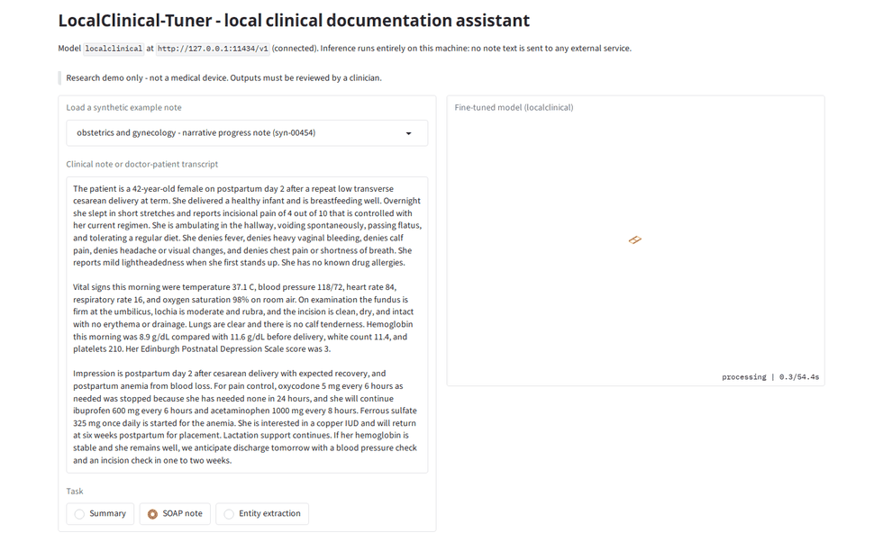
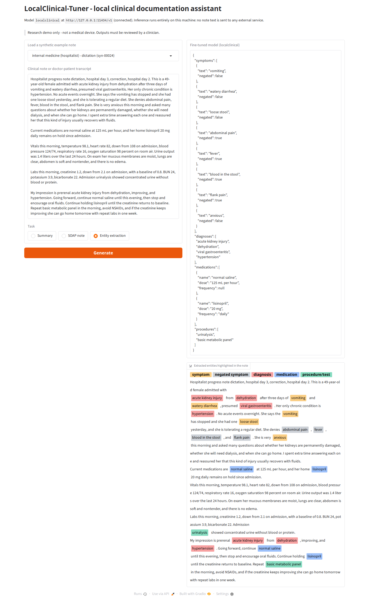
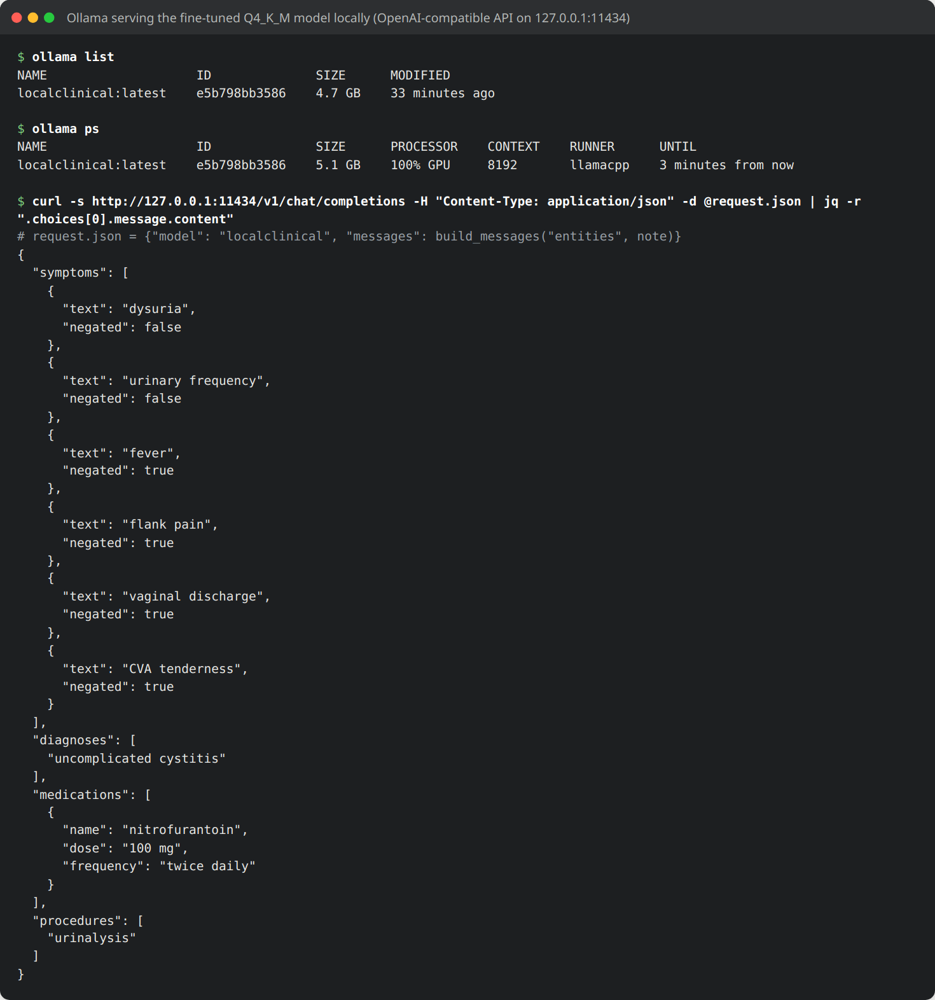
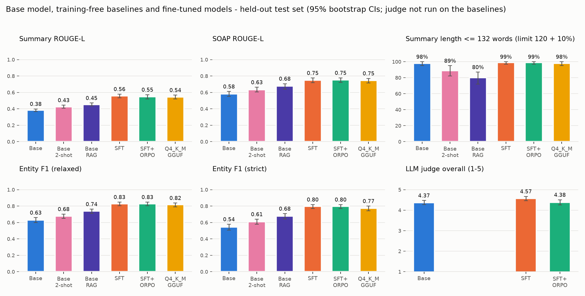
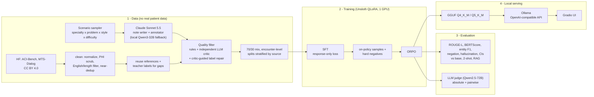

# LocalClinical-Tuner

**A clinical-documentation assistant that runs 100% on your own hardware: an open 7B model fine-tuned to summarize
encounter notes, write SOAP notes and extract medical entities, served offline from a single 4.4 GB file.**

[](LICENSE)
[](.python-version)
[](#how-this-repository-keeps-inference-local-verified)
[](#quickstart-run-the-demo)
[](https://huggingface.co/Qwen/Qwen2.5-7B-Instruct)
[](https://github.com/unslothai/unsloth)

> [!WARNING]
> **Research project - not for clinical use.** This is not a medical device and has not been validated on real
> patients. It was trained and evaluated **without any real patient data** (synthetic notes and public, role-played
> doctor-patient dialogues only). Do not use it to make or support clinical decisions, and do not use it on real
> patient records. See the full [Disclaimer](#disclaimer).



*The local demo streaming a SOAP note from the compressed fine-tuned model (real output, synthetic example note).*

**How it is built:** synthetic + public de-identified data → quality-filtered dataset → **Unsloth QLoRA SFT** →
**ORPO** preference optimization → evaluation against the base model and training-free baselines (reference metrics +
independent LLM judge) → **GGUF** → **Ollama / OpenAI-compatible API / Gradio**.

**Jump to:** [Quickstart](#quickstart-run-the-demo) · [Headline results](#headline-results) ·
[Scientific caveats](#reading-the-results-scientific-caveats) · [FAQ](docs/FAQ.md) ·
[Reproduce everything](#reproduce-everything) · [Data card](data/DATA_CARD.md)

---

## Quickstart: run the demo

> [!IMPORTANT]
> **Models are large and are not stored in git.** The demo runs the exported model file
> `outputs/gguf/localclinical-q4_k_m.gguf` (4.4 GB). Pre-built weights are **not published yet**, so for now the file
> has to come from a pipeline run:
>
> * **Build it:** run the pipeline ([Reproduce everything](#reproduce-everything)); `serving/export_gguf.py` writes it.
>   Training needs one 24 GB GPU (see [Hardware](#hardware)).
> * **Copy it** from a machine where the pipeline ran into `outputs/gguf/`, or point the demo at it with
>   `GGUF=/path/to/localclinical-q4_k_m.gguf`.

**What you need to run the demo:**

| | |
|---|---|
| **OS** | Linux or macOS with bash (on Windows, use WSL2: the demo script is a bash script) |
| **Tools** | [uv](https://docs.astral.sh/uv/) and [Ollama](https://ollama.com/download) (tested with 0.40.2) |
| **Inference hardware** | about **5 GB of GPU memory** (measured: 5.1 GB on an RTX A6000 at an 8,192-token context, all 29 layers on the GPU). Ollama can also run the model on CPU or Apple Silicon; that is slower and was not benchmarked here. |
| **Network** | none once Ollama, the Python packages and the model file are on the machine |

From a fresh clone:

```bash
git clone https://github.com/MehranKeivanimehr/LocalClinical-Tuner.git && cd LocalClinical-Tuner
```

```bash
uv sync --locked --extra serve
```

Place `localclinical-q4_k_m.gguf` in `outputs/gguf/` (see above), check it against the reference run's SHA-256
(`sha256sum outputs/gguf/localclinical-q4_k_m.gguf`; on macOS `shasum -a 256 ...`), and start the demo:

```text
2fca1270b90fc502e257109ad0e3cc0c508028cf36eafc71a3f6b1480eab300b  localclinical-q4_k_m.gguf
5d4b3fe1ab68d97a8deba534b9e7e111140864e9679758f9f0e7745091095ac4  localclinical-q5_k_m.gguf
```

```bash
bash scripts/run_demo.sh
```

The script starts Ollama on `127.0.0.1:11434` (if it is not already running) with cloud features disabled, registers
`serving/ollama_modelfile` as the model `localclinical`, and opens the Gradio UI at http://127.0.0.1:7860. Pick an
example note (all synthetic), choose a task, and press **Generate**. On a machine with several GPUs, pin Ollama to one
of them (its Vulkan backend ignores `CUDA_VISIBLE_DEVICES`, hence `OLLAMA_VULKAN=0`):

```bash
CUDA_VISIBLE_DEVICES=0 OLLAMA_VULKAN=0 bash scripts/run_demo.sh
```



The same model is available to any OpenAI-compatible client. For the best results send the exact training prompt,
which `build_messages(task, note)` builds:

```bash
uv run python -c "import json, sys; from clinical_tuner.prompts import build_messages; print(json.dumps({'model': 'localclinical', 'temperature': 0, 'messages': build_messages('entities', open(sys.argv[1]).read())}))" note.txt > request.json
```

```bash
curl -s http://127.0.0.1:11434/v1/chat/completions -H "Content-Type: application/json" -d @request.json | jq -r '.choices[0].message.content'
```



**Verified on the final model** (reference machine, one RTX A6000): the UI was driven end to end through its own API
and in a real browser - all three tasks, the example picker and the empty-input error. Ollama keeps the whole model on
the GPU (29/29 layers, 5.1 GB at an 8,192-token context). Once loaded, a summary took 3.8 s and a SOAP note or entity
extraction about 10 s; the first request after start-up also loads the model and is slower. llama.cpp's own server
works too: `llama-server -m outputs/gguf/localclinical-q4_k_m.gguf --port 8080` exposes `/v1/chat/completions` with the
GGUF's embedded chat template.

### Troubleshooting the demo

| Symptom | What to do |
|---|---|
| `Ollama is not installed` | Install it from [ollama.com/download](https://ollama.com/download) (Linux: `curl -fsSL https://ollama.com/install.sh \| sh`) or point `OLLAMA_BIN` at the binary. |
| `GGUF not found at ...` | The weights are not in git (see the box above). Put the file in `outputs/gguf/` or run `GGUF=/path/to/localclinical-q4_k_m.gguf bash scripts/run_demo.sh`. |
| Port 7860 is already in use | `bash scripts/run_demo.sh --port 7861` (extra arguments are passed to `serving/gradio_app.py`). |
| Port 11434 is used by another program | `OLLAMA_HOST=127.0.0.1:11435 bash scripts/run_demo.sh` |
| An Ollama server is already running (for example the system service) | The script reuses it as it is, so `OLLAMA_NO_CLOUD=1` only takes effect when the script starts Ollama itself. Stop the running server first, or set `OLLAMA_NO_CLOUD=1` in its environment. |
| The UI says the model is `NOT reachable` | Ollama is not running at the configured address. Start the demo with `scripts/run_demo.sh` rather than `serving/gradio_app.py` on its own. |
| Generation is slow | Run `ollama ps`: the PROCESSOR column should read `100% GPU`. If it shows CPU, Ollama cannot see the GPU - check `nvidia-smi` (NVIDIA) and the driver note under [Hardware](#hardware). On a multi-GPU machine, pin one GPU as shown above. |
| `nvidia-smi` reports *Driver/library version mismatch* | Usually an automatic driver update without a reboot; reboot the machine (details under [Hardware](#hardware)). |
| You want to work fully offline | The demo never contacts Hugging Face, and the UI loads no remote assets. For training and evaluation, download the models once and then set `HF_HUB_OFFLINE=1`. |

## Headline results

All numbers are measured on **300 held-out test examples** (100 encounters never seen in training: 70 synthetic, 26
MTS-Dialog, 4 ACI-Bench), with identical prompts and greedy decoding for every model. Read them together with the
[scientific caveats](#reading-the-results-scientific-caveats) below.

<!-- BEFORE_AFTER:START -->
| Metric (300 held-out test examples) | **Before**: base Qwen2.5-7B-Instruct | **SFT** | **SFT+ORPO**, 16-bit (exported) | **SFT+ORPO, Q4_K_M GGUF**, 4.4 GB (what the demo runs) | Change (SFT+ORPO − base) |
|---|---|---|---|---|---|
| Summary ROUGE-L | 0.383 | 0.558 | 0.548 | 0.544 | +0.165 (+43%) |
| Summary BERTScore F1 | 0.411 | 0.569 | 0.567 | 0.559 | +0.156 (+38%) |
| SOAP note ROUGE-L | 0.583 | 0.749 | 0.752 | 0.747 | +0.168 (+29%) |
| SOAP note BERTScore F1 | 0.471 | 0.736 | 0.748 | 0.737 | +0.277 (+59%) |
| Entity extraction F1 (relaxed) | 0.630 | 0.829 | 0.829 | 0.816 | +0.198 (+31%) |
| Entity extraction F1 (strict) | 0.544 | 0.798 | 0.796 | 0.774 | +0.252 (+46%) |
| Denied symptoms kept as denied | 97.6% | 100.0% | 100.0% | 99.9% | +2.4 pts |
| Summaries within 132 words (limit 120 + 10%) | 98.0% | 99.0% | 99.0% | 98.0% | +1.0 pts |
| LLM-judge overall score (1-5) | 4.373 | 4.573 | 4.384 | n/a | +0.010 (+0%) |

Change = SFT+ORPO (16-bit) minus base. The judge scored the 16-bit models only, on 150 of the test examples. SFT and SFT+ORPO are within each other's 95% CIs on every reference metric above. Head to head, the judge does not prefer the ORPO stage: SFT+ORPO vs SFT win / tie / loss 5% / 74% / 21%. Confidence intervals and the training-free baselines (2-shot prompting, RAG): [Full comparison](#full-comparison).
<!-- BEFORE_AFTER:END -->

* **Supervised fine-tuning (SFT) produces the gains.** Training-free alternatives on the same base model close part of
  the gap: retrieving two similar training examples into the prompt (RAG) recovers roughly half of it (entity F1 0.630
  → 0.738 vs 0.829 after SFT).
* **The preference stage (ORPO) adds no measurable gain**, and the judge slightly prefers plain SFT
  ([why](#why-the-orpo-stage-added-little)).
* **4-bit compression costs little:** the 4.4 GB GGUF stays inside the 95% CIs of its 16-bit source on every metric.

Full comparison with CIs and baselines: [below](#full-comparison) · per-source tables:
[results/comparison_table.md](results/comparison_table.md) · raw numbers: [results/metrics.json](results/metrics.json)
· side-by-side generations: [results/sample_outputs.md](results/sample_outputs.md)

## Who this is for

**For:**

* People building **local LLM** applications who want a complete, reproducible example: data → QLoRA SFT → preference
  optimization → evaluation → GGUF → Ollama.
* **Privacy-preserving ML** demos: a narrow model that never sends text off the machine.
* Learning when **fine-tuning beats prompting or RAG** on a narrow domain, with the baselines measured on the same test
  set.

**Not for:**

* Clinical deployment, diagnosis, triage or any clinical decision support.
* Processing **real patient notes** without a full clinical validation pipeline (clinician-verified labels, evaluation
  on representative real data, and the governance your institution requires).

## Reading the results: scientific caveats

* **Most labels are model-generated, not clinician-verified.** All synthetic notes and their labels were written by an
  LLM, and most public-dialogue labels were written by a local LLM teacher; only some ACI-Bench SOAP notes and
  MTS-Dialog summaries reuse human-written references ([data card](data/DATA_CARD.md)). The fine-tuned model learns
  the conventions *and the mistakes* of these labels.
* **The test set is mostly synthetic, and the public slices are small.** 70 of the 100 test encounters are synthetic,
  26 MTS-Dialog and only 4 ACI-Bench, so per-source numbers for ACI-Bench are anecdotal. Gains are largest on the
  synthetic slice: summary ROUGE-L rises 0.370 → 0.579 (base → SFT) on synthetic notes, 0.409 → 0.515 on MTS-Dialog and
  0.433 → 0.468 on ACI-Bench ([per-source tables](results/comparison_table.md#by-data-source)).
* **Automatic metrics measure agreement with the reference, not clinical correctness.** ROUGE-L, BERTScore and entity
  F1 reward matching the wording and format of the (model-written) references. In the [qualitative
  examples](#qualitative-examples-side-by-side) the base model invents an age, a sex and a plan and still gets a
  slightly higher ROUGE-L than the fine-tuned models.
* **The LLM judge is an auxiliary signal.** The judge (Qwen2.5-72B-Instruct) is from the same model family as the base
  model, it also served as the quality critic for the public dialogues (it filtered them but wrote no labels), its
  pairwise verdicts agree across the two presentation orders only 50-60% of the time, and it gave different scores to
  identical outputs. Head to head it prefers the base model's SOAP notes (50% vs 10%), mostly a style preference.
* **SFT drives the gains; ORPO adds little.** On reference metrics SFT and SFT+ORPO are statistically
  indistinguishable, and the judge prefers SFT over SFT+ORPO (win / tie / loss 5% / 74% / 21%; overall 4.57 vs 4.38).
  The exported model is SFT+ORPO only because it was selected on validation data before the test set was scored.
* **RAG closes part of the gap; fine-tuning still wins on format and leakage.** With retrieved or fixed examples in
  the prompt, summaries stay within the length limit less often (80% with RAG, 89% with 2-shot, 99% after fine-tuning),
  prompts are about 3× (2-shot) and 4.4× (RAG) longer, and 2-shot prompting copied a medication (*Toprol*) from its examples into 3 of 100 SOAP
  notes. The fine-tuned model carries the format in its weights and needs no examples in the prompt.

## Why this project exists

Clinicians spend a large share of their day on documentation: turning a visit into a note, a SOAP structure and a
list of problems and medications. Language models are good at exactly this kind of text transformation. The obvious
route - sending encounter text to a hosted model - collides with how clinical data has to be handled. This project
shows the alternative: **bring a small, specialised model to the data instead of sending the data to a model.**

### Privacy

* **Encounter notes are protected health information (PHI).** Under HIPAA, sending them to a third-party service
  requires a Business Associate Agreement, vendor risk review, retention and data-residency guarantees, and audit
  trails. Many hospitals and clinics do not allow it at all.
* **De-identification before sending is not a reliable shield.** Names, dates, places and rare conditions leak through
  automated scrubbing; free text is the hardest data type to de-identify.
* **A model that never leaves the building removes the problem rather than managing it**: no third-party processor,
  no data in transit to a vendor, no logs on someone else's servers.

### Personal data

* Health data is among the most sensitive personal data there is (for example, a "special category" under the EU
  GDPR). The safest data-protection posture is **data minimisation**: do not copy it, do not transmit it, do not let
  anyone else store it.
* This repository applies the same rule to itself: **no real patient data was used anywhere**. The training notes are
  synthetic (written from fictional scenarios) or public role-played dialogues released under CC BY 4.0; the hosted
  model used to write the synthetic notes only ever saw those fictional scenarios. Identifier patterns are scrubbed
  and checked automatically (see [Data quality](#data-quality-how-the-dataset-was-built-and-checked)).

### Local run and operation

* **Runs on hardware you control.** The compressed model is a 4.4 GB file that needs about 5 GB of GPU memory (or runs
  on CPU / Apple Silicon through Ollama, slower and not benchmarked here). Training needs one GPU with 24 GB (the optional data-generation and
  judging steps use larger local models; see [Hardware](#hardware)).
* **Works offline.** Once the models are downloaded, nothing needs the network (`HF_HUB_OFFLINE=1` for training;
  Ollama and the UI never need it).
* **Stable and auditable.** The weights are a single file with a SHA-256 checksum (recorded by the export step and
  listed under [Quickstart](#quickstart-run-the-demo)); they do not change underneath a workflow, and a validated
  version can be frozen like any other software artifact.
* **Predictable cost and latency.** No per-token fees and no network round trip: on the reference machine a summary
  takes about 4 seconds once the model is loaded.

#### How this repository keeps inference local (verified)

* Every server binds to `127.0.0.1`: Ollama (`:11434`), the Gradio UI (`:7860`) and the vLLM servers used in the
  pipeline. Gradio runs with analytics disabled and never creates a public share link.
* Ollama is started with `OLLAMA_NO_CLOUD=1` (cloud inference and web search off) by `scripts/run_demo.sh` and by the
  pipeline.
* Checked on the final model: when the UI was loaded in a browser, every request went to `127.0.0.1` (fonts and
  assets are served locally), and while the demo was idle neither Gradio nor Ollama had a connection to any non-local
  address.
* For real or sensitive notes, `data/import_external_notes.py --private` scrubs identifiers and marks the records so
  that the labelling and quality-filter steps send them only to local models, never to a remote API.

## Highlights

| Stage | What it does |
|---|---|
| **Data** | 1,000 encounters × 3 tasks = 3,000 instruction examples in the reference run (scales via `data.composition.total_encounters`). **70% synthetic** notes written by Claude from 164 presenting problems across 20 specialties × 8 note styles × 3 difficulty levels (via the Anthropic API, or via prompt batches run in the Claude app / Claude Code - no API key needed; the reference run used the batch route); **30% public CC BY 4.0** doctor-patient dialogues (ACI-Bench, MTS-Dialog), license-checked, PHI-scrubbed, English/length-filtered and near-deduplicated against the synthetic set. |
| **Quality filter** | Runs on both sources: rule-based clinical sanity checks (vital/lab plausibility, drug max-dose table, age/sex consistency, allergy-vs-prescription conflicts, SOAP completeness, entity grounding, hallucinated medications, negation consistency) **+ an LLM critic that is always a different model from the record's generator**, itself validated with injected errors. Critic-rejected public dialogues get their labels rewritten from the critic's findings and re-audited. A [data card](data/DATA_CARD.md) records sources, licenses and rejection statistics. |
| **SFT** | Unsloth + QLoRA (4-bit NF4 base, LoRA r=32 on all attention/MLP projections, optional DoRA), loss on assistant tokens only (verified by an automatic label-mask check). |
| **Preference optimization** | **ORPO** (reference-free odds-ratio loss; DPO selectable) on pairs mined from the SFT model's *own* samples plus targeted clinical hard negatives. NLL term on response tokens only (fixes TRL's prompt+response default); λ chosen on the validation split. |
| **Evaluation** | ROUGE-L, BERTScore, entity F1 (strict + relaxed), negation accuracy, SOAP structure, JSON validity, medication hallucination, length compliance - bootstrap 95% CIs, per task and per data source; **LLM-as-a-judge** (Qwen2.5-72B, which generated none of the training data). Compared against the base model, **2-shot prompting** and **simple RAG** baselines, and the compressed model. |
| **Serving** | GGUF Q4_K_M + Q5_K_M via llama.cpp, an Ollama Modelfile whose prompt format matches training token for token, an OpenAI-compatible endpoint, a Gradio UI with entity highlighting, and a one-command demo. |

## Detailed results

The [headline table](#headline-results) above summarizes these numbers; everything below uses the same 300 held-out
test examples.

### Full comparison

<!-- RESULTS:START -->
**Headline (base → 2-shot → RAG → SFT → SFT+ORPO):** entity F1 0.630 → 0.677 → 0.738 → 0.829 → 0.829; SOAP ROUGE-L 0.583 → 0.635 → 0.677 → 0.749 → 0.752; summary ROUGE-L 0.383 → 0.427 → 0.454 → 0.558 → 0.548; LLM-judge pairwise win/tie/loss %: SFT+ORPO vs base 21/45/34; SFT+ORPO vs SFT 5/74/21; SFT vs base 25/41/33.

Dataset: 1,000 encounters / 3,000 examples (70% synthetic).

<picture>
  <source media="(prefers-color-scheme: dark)" srcset="results/figures/key_metrics_dark.png">
  
</picture>

Full per-source breakdown: [results/comparison_table.md](results/comparison_table.md); raw numbers: [results/metrics.json](results/metrics.json); side-by-side generations: [results/sample_outputs.md](results/sample_outputs.md).


Test set: **300 examples** from 100 held-out encounters (sources: aci-bench, mts-dialog, synthetic). Greedy decoding with identical settings for every model ({'temperature': 0.0, 'max_tokens': 1536, 'repetition_penalty': 1.05}). Values are means with bootstrap 95% CI over test examples (1000 resamples) in parentheses.

#### Main comparison

| Metric | Base (Qwen2.5-7B-Instruct) | Base + 2-shot prompting | Base + RAG (2 retrieved examples) | SFT | SFT + ORPO | SFT + ORPO (Q4_K_M GGUF) |
|---|---|---|---|---|---|---|
| Summary ROUGE-L ↑ | 0.383 (0.368-0.399) | 0.427 (0.409-0.445) | 0.454 (0.435-0.471) | **0.558 (0.535-0.580)** | 0.548 (0.522-0.573) | 0.544 (0.519-0.568) |
| Summary BERTScore F1 ↑ | 0.411 (0.392-0.430) | 0.454 (0.433-0.475) | 0.482 (0.460-0.503) | **0.569 (0.547-0.590)** | 0.567 (0.545-0.588) | 0.559 (0.535-0.582) |
| Summary key-entity coverage ↑ | 67.0% (61.4-72.8) | 75.3% (70.4-80.2) | 75.5% (71.0-80.6) | 77.2% (72.6-81.5) | 75.1% (70.5-79.7) | **79.5% (75.1-83.5)** |
| Summary length ≤ 132 words (120 + 10%) ↑ | 98.0% (95.0-100.0) | 89.0% (82.0-95.0) | 80.0% (72.0-87.0) | **99.0% (97.0-100.0)** | **99.0% (97.0-100.0)** | 98.0% (95.0-100.0) |
| Summary medication hallucination ↓ | **0.0% (0.0-0.0)** | **0.0% (0.0-0.0)** | **0.0% (0.0-0.0)** | **0.0% (0.0-0.0)** | **0.0% (0.0-0.0)** | **0.0% (0.0-0.0)** |
| SOAP ROUGE-L ↑ | 0.583 (0.553-0.611) | 0.635 (0.604-0.663) | 0.677 (0.642-0.707) | 0.749 (0.718-0.776) | **0.752 (0.721-0.778)** | 0.747 (0.716-0.772) |
| SOAP BERTScore F1 ↑ | 0.471 (0.454-0.489) | 0.575 (0.551-0.600) | 0.660 (0.633-0.685) | 0.736 (0.701-0.765) | **0.748 (0.727-0.769)** | 0.737 (0.716-0.758) |
| SOAP structure adherence ↑ | 99.2% (97.8-100.0) | 99.8% (99.2-100.0) | **100.0% (100.0-100.0)** | **100.0% (100.0-100.0)** | **100.0% (100.0-100.0)** | **100.0% (100.0-100.0)** |
| SOAP key-entity coverage ↑ | 94.6% (91.8-97.0) | 95.3% (92.8-97.5) | 96.1% (93.7-98.0) | 95.4% (92.7-97.9) | 96.3% (93.6-98.4) | **97.1% (95.1-98.9)** |
| SOAP medication hallucination ↓ | **0.0% (0.0-0.0)** | 3.0% (0.0-7.0) | **0.0% (0.0-0.0)** | **0.0% (0.0-0.0)** | **0.0% (0.0-0.0)** | **0.0% (0.0-0.0)** |
| Entity F1 (relaxed) ↑ | 0.630 (0.600-0.659) | 0.677 (0.651-0.703) | 0.738 (0.711-0.763) | **0.829 (0.803-0.849)** | 0.829 (0.803-0.849) | 0.816 (0.790-0.838) |
| Entity F1 (strict) ↑ | 0.544 (0.507-0.579) | 0.610 (0.577-0.640) | 0.679 (0.645-0.708) | **0.798 (0.771-0.819)** | 0.796 (0.769-0.819) | 0.774 (0.744-0.800) |
| Symptom negation accuracy ↑ | 97.6% | 98.6% | 99.6% | **100.0%** | **100.0%** | 99.9% |
| Valid JSON ↑ | **100.0% (100.0-100.0)** | **100.0% (100.0-100.0)** | **100.0% (100.0-100.0)** | **100.0% (100.0-100.0)** | **100.0% (100.0-100.0)** | **100.0% (100.0-100.0)** |

#### LLM-as-a-judge (judge: `Qwen/Qwen2.5-72B-Instruct`, reference-free, 1-5)

| Dimension | Base (Qwen2.5-7B-Instruct) | SFT | SFT + ORPO |
|---|---|---|---|
| faithfulness | 4.480 (4.360-4.593) | 4.720 (4.627-4.807) | 4.500 (4.370-4.637) |
| completeness | 4.307 (4.180-4.433) | 4.493 (4.360-4.620) | 4.308 (4.164-4.452) |
| format | 4.927 (4.873-4.973) | 4.933 (4.860-4.987) | 4.829 (4.733-4.918) |
| clinical_usefulness | 4.487 (4.380-4.587) | 4.607 (4.473-4.720) | 4.418 (4.274-4.569) |
| overall | 4.373 (4.267-4.473) | 4.573 (4.467-4.673) | 4.384 (4.260-4.507) |

**Pairwise (each comparison judged in both presentation orders; disagreement counts as a tie)**

| Comparison | n | win | tie | loss | position consistency |
|---|---|---|---|---|---|
| SFT + ORPO vs Base (Qwen2.5-7B-Instruct) | 150 | 20.7% | 45.3% | 34.0% | 56.0% |
| SFT + ORPO vs SFT | 150 | 4.7% | 74.0% | 21.3% | 50.0% |
| SFT vs Base (Qwen2.5-7B-Instruct) | 150 | 25.3% | 41.3% | 33.3% | 60.0% |

Pairwise by task (win / tie / loss, %):

| Comparison | summary | soap | entities |
|---|---|---|---|
| SFT + ORPO vs Base (Qwen2.5-7B-Instruct) | 22 / 54 / 24 | 12 / 48 / 40 | 28 / 34 / 38 |
| SFT + ORPO vs SFT | 8 / 74 / 18 | 2 / 76 / 22 | 4 / 72 / 24 |
| SFT vs Base (Qwen2.5-7B-Instruct) | 30 / 50 / 20 | 10 / 40 / 50 | 36 / 34 / 30 |
<!-- RESULTS:END -->

### Comparison with simpler baselines (prompting only, simple RAG)

Is fine-tuning needed at all, or would a better prompt do? Two training-free baselines run on the **same base model,
prompts, decoding and test set** (`training/evaluate.py generate --prompting fewshot|rag`,
`src/clinical_tuner/baselines.py`):

* **Base + 2-shot prompting** - two fixed worked examples (note → reference answer) from the training split, one
  synthetic and one public dialogue, placed in the chat before the test note.
* **Base + RAG** - the two training notes most similar to the test note (BM25 over the training split, i.e. the same
  data the fine-tuned model learned from) and their reference answers, placed in the chat before the test note.

What the numbers in the [full comparison](#full-comparison) show:

* **Each step helps, but fine-tuning is clearly ahead.** Entity F1 (relaxed) goes 0.630 (base) → 0.677 (2-shot) →
  0.738 (RAG) → **0.829 (SFT)**; SOAP ROUGE-L 0.583 → 0.635 → 0.677 → **0.749**; summary ROUGE-L 0.383 → 0.427 → 0.454
  → **0.558**. RAG recovers roughly half of the gap between the base model and the fine-tuned one.
* **In-context examples leak into the output.** With 2-shot prompting, 3 of 100 SOAP notes (3.0%) contained a
  medication that is not in the patient's note - in all three cases *Toprol*, copied from one of the worked examples.
  It is the only non-zero medication-hallucination rate in the whole evaluation; the fine-tuned models have none.
* **Examples cost format compliance and context.** Summaries within the length limit drop from 98% (base) to 89%
  (2-shot) and 80% (RAG), versus 99% after fine-tuning; prompts grow from 749 tokens on average to 2,215 (2-shot) and
  3,291 (RAG), which is slower and needs a larger context window at inference time.
* The fine-tuned model needs none of this at inference time: the task format lives in the weights, so the prompt is
  just the instruction and the note.

The LLM judge was not run on the two baselines: they were added after a driver update on the shared cluster disabled
multi-GPU communication (NCCL), which the 72B judge needs. The judge stage is resumable, so
`uv run python training/evaluate.py judge` adds them once two GPUs are available.

### Qualitative examples (side by side)

<!-- QUALITATIVE:START -->
One held-out test note per task, picked at random (seed 3407) among notes under 350 words so the page stays readable - not cherry-picked. Each column is scored against the reference answer (ROUGE-L for text, relaxed entity F1 for extraction). Entity JSON is shown in compact form.

#### Summary - `mts-train-1066` (mts-dialog, dialogue transcript)

<details><summary>Source note (103 words) and reference answer</summary>

```text
Doctor: You do not look so well today. What seems to be the problem?
Patient: Well‚ I am having a hard time. My whole body aches and I am in pain.
Doctor: Do you have a history of drug use?
Patient: Well yes. I am detoxing.
Doctor: What kind of drugs have you been using?
Patient: Heroin.
Doctor: Okay. How long have you been using?
Patient: I don't feel well. Maybe a year. I can't sleep or eat.
Doctor: Have you had a fever, chills, vomiting or diarrhea?
Patient: I think I have a fever. I feel chilled. I have had some diarrhea.
```

Reference:

```text
The patient is experiencing body aches and pain. They report a history of heroin use and are currently detoxing. They have had trouble sleeping, eating, and have had a fever, chills, and diarrhea. The assessment and plan are not documented.
```

</details>

<table>
<tr><th>Base model (before)</th><th>Fine-tuned (SFT)</th><th>Compressed: SFT+ORPO, Q4_K_M GGUF (what the demo runs)</th></tr>
<tr>
<td valign="top">The 35-year-old male presented with complaints of body aches and pain, reporting a history of heroin use during detoxification. He mentioned difficulty sleeping and eating for about a year. The patient also reported feeling chilled and having a fever along with some diarrhea. The assessment suggests acute symptoms possibly related to his detoxification process. The plan includes monitoring his symptoms and providing supportive care.</td>
<td valign="top">The patient is a person with a history of heroin use who is currently detoxing. They report widespread body aches, pain, difficulty sleeping, and loss of appetite. The patient also mentions feeling feverish and chilled, along with some diarrhea. They are experiencing significant distress and are seeking medical attention.</td>
<td valign="top">The patient is a person with a history of heroin use who is currently detoxing. They report whole-body aches, pain, and difficulty sleeping or eating. The patient also mentions feeling chilled and having some diarrhea. They suspect they may have a fever. The doctor observes that the patient does not look well and inquires about their symptoms.</td>
</tr>
<tr><td><i>ROUGE-L 0.40</i></td><td><i>ROUGE-L 0.38</i></td><td><i>ROUGE-L 0.39</i></td></tr>
</table>

#### SOAP note - `syn-00097` (synthetic, urology, telehealth note)

<details><summary>Source note (266 words) and reference answer</summary>

```text
Visit modality: telephone visit, audio only, with the patient at home. His identity was confirmed and he agreed to be seen by phone.

The patient is an 86-year-old male with benign prostatic hyperplasia who reports worsening urinary symptoms over the past 3 months. He describes a weak urinary stream, hesitancy, urinary frequency during the day, and nocturia with 3 trips to the bathroom each night. He denies burning with urination, blood in the urine, fever, and back pain. He has not had any episodes of urinary retention. His self-completed symptom score is 17, which is moderate, with a bother score of 4. He takes tamsulosin 0.4 mg daily. He has a documented allergy to penicillin, which causes hives.

Home measurements: blood pressure 134/80 on his home cuff and pulse 72. No video was available, so no physical examination was performed; he sounds comfortable and speaks in full sentences on the phone.

Impression is benign prostatic hyperplasia with lower urinary tract symptoms, only partly controlled on tamsulosin. Plan is to continue tamsulosin 0.4 mg daily and add finasteride 5 mg daily. A baseline PSA and urinalysis will be drawn at the lab before the first dose of finasteride. He should limit caffeine and evening fluids and avoid over-the-counter decongestants. Because of his penicillin allergy, a non-penicillin antibiotic will be chosen if a urinary tract infection is ever diagnosed. He will come in for a visit with a bladder scan for post-void residual in 3 months. He should call sooner or go to the emergency department if he cannot urinate, develops fever, or sees blood in his urine.
```

Reference:

```text
SUBJECTIVE:
Telephone visit (audio only) with the patient at home. 86-year-old male with benign prostatic hyperplasia reporting 3 months of worsening urinary symptoms: weak urinary stream, hesitancy, daytime urinary frequency, and nocturia with 3 trips to the bathroom each night. Denies burning with urination, blood in the urine, fever, back pain, and urinary retention. Self-completed symptom score is 17 (moderate) with a bother score of 4. Takes tamsulosin 0.4 mg daily. Documented allergy to penicillin causing hives.

OBJECTIVE:
Home blood pressure 134/80 and pulse 72. No video and no physical examination; sounds comfortable and speaks in full sentences by phone.

ASSESSMENT:
Benign prostatic hyperplasia with lower urinary tract symptoms, only partly controlled on tamsulosin.

PLAN:
1. Continue tamsulosin 0.4 mg daily
2. Add finasteride 5 mg daily after a baseline PSA and urinalysis are drawn at the lab
3. Limit caffeine and evening fluids and avoid over-the-counter decongestants
4. Use a non-penicillin antibiotic if a urinary tract infection is ever diagnosed because of the penicillin allergy
5. Visit with bladder scan for post-void residual in 3 months
6. Call sooner or go to the emergency department if unable to urinate, fever, or blood in the urine
```

</details>

<table>
<tr><th>Base model (before)</th><th>Fine-tuned (SFT)</th><th>Compressed: SFT+ORPO, Q4_K_M GGUF (what the demo runs)</th></tr>
<tr>
<td valign="top">SUBJECTIVE:<br>Chief Complaint: Worsening urinary symptoms over the past 3 months.<br>History of Present Illness: The patient is an 86-year-old male with benign prostatic hyperplasia reporting a weak urinary stream, hesitancy, urinary frequency during the day, and nocturia with 3 trips to the bathroom each night. He denies burning with urination, blood in the urine, fever, and back pain. He has not had any episodes of urinary retention. His self-completed symptom score is 17, which is moderate, with a bother score of 4.<br>Relevant History: Benign prostatic hyperplasia.<br>Medications: Tamsulosin 0.4 mg daily.<br>Allergies: Penicillin, which causes hives.<br>Social History: Not documented.<br><br>OBJECTIVE:<br>Vital Signs: Blood pressure 134/80, pulse 72.<br>Examination Findings: Not documented due to lack of physical examination.<br>Test Results: Not documented.<br><br>ASSESSMENT:<br>Benign prostatic hyperplasia with lower urinary tract symptoms, only partly controlled on tamsulosin.<br><br>PLAN:<br>1. Continue tamsulosin 0.4 mg daily.<br>2. Add finasteride 5 mg daily.<br>3. Draw a baseline PSA and urinalysis at the lab before the first dose of finasteride.<br>4. Limit caffeine and evening fluids.<br>5. Avoid over-the-counter decongestants.<br>6. Choose a non-penicillin antibiotic if a urinary tract infection is ever diagnosed.<br>7. Come in for a visit with a bladder scan for post-void residual in 3 months.<br>8. Call sooner or go to the emergency department if he cannot urinate, develops fever, or sees blood in his urine.</td>
<td valign="top">SUBJECTIVE:<br>Telephone visit with the patient at home. Reports worsening urinary symptoms over 3 months: weak urinary stream, hesitancy, daytime urinary frequency, and nocturia with 3 trips to the bathroom each night. Denies burning with urination, blood in the urine, fever, and back pain; no episodes of urinary retention. Self-completed symptom score 17 (moderate) and bother score 4. Takes tamsulosin 0.4 mg daily. Documented allergy to penicillin causing hives.<br><br>OBJECTIVE:<br>Home blood pressure 134/80 and pulse 72. No video available, so no physical examination was done; he sounds comfortable and speaks in full sentences. Symptom score and bother score from the patient.<br><br>ASSESSMENT:<br>Benign prostatic hyperplasia with lower urinary tract symptoms, only partly controlled on tamsulosin.<br><br>PLAN:<br>1. Continue tamsulosin 0.4 mg daily<br>2. Start finasteride 5 mg daily<br>3. Baseline PSA and urinalysis at the lab before the first dose of finasteride<br>4. Limit caffeine and evening fluids and avoid over-the-counter decongestants<br>5. Non-penicillin antibiotic chosen if a urinary tract infection is diagnosed because of the penicillin allergy<br>6. Bladder scan for post-void residual in 3 months<br>7. Call sooner or go to the emergency department for inability to urinate, fever, or blood in the urine</td>
<td valign="top">SUBJECTIVE:<br>86-year-old male with benign prostatic hyperplasia reports worsening urinary symptoms over 3 months: weak urinary stream, hesitancy, daytime urinary frequency, and nocturia with 3 trips to the bathroom each night. Denies burning with urination, blood in the urine, fever, and back pain; no episodes of urinary retention. Self-completed symptom score 17 (moderate) and bother score 4. Takes tamsulosin 0.4 mg daily. Documented allergy to penicillin causing hives.<br><br>OBJECTIVE:<br>Telephone visit with home cuff: blood pressure 134/80, pulse 72. No physical examination performed; patient sounds comfortable and speaks in full sentences. No video available.<br><br>ASSESSMENT:<br>Benign prostatic hyperplasia with lower urinary tract symptoms, only partly controlled on tamsulosin.<br><br>PLAN:<br>1. Continue tamsulosin 0.4 mg daily<br>2. Start finasteride 5 mg daily; baseline PSA and urinalysis at the lab before the first dose<br>3. Limit caffeine and evening fluids and avoid over-the-counter decongestants<br>4. Choose a non-penicillin antibiotic if a urinary tract infection is diagnosed because of his penicillin allergy<br>5. Bladder scan for post-void residual in 3 months<br>6. Call sooner or go to the emergency department for inability to urinate, fever, or blood in the urine</td>
</tr>
<tr><td><i>ROUGE-L 0.70</i></td><td><i>ROUGE-L 0.82</i></td><td><i>ROUGE-L 0.85</i></td></tr>
</table>

#### Entity extraction - `mts-train-310` (mts-dialog, dialogue transcript)

<details><summary>Source note (163 words) and reference answer</summary>

```text
Doctor: Is this baby number two?
Patient: Yes, this is baby number two.
Doctor: How many times have you been pregnant, including miscarriages or abortions if any?
Patient: I've been pregnant two times in total. No miscarriages or abortions.
Doctor: When was your last period?
Patient: About a month ago.
Doctor: And how would you describe your periods? Light, normal, heavy?
Patient: Pretty normal.
Doctor: Any abnormal pap smears?
Patient: No, fortunately they've all been normal.
Doctor: That's wonderful to hear. And my last question for you is if you've ever gotten a mammogram?
Patient: I haven't gotten one before. Do I need to get one? I just turned thirty nine. What's the recommended age again?
Doctor: It depends. For example, the recommended age would be younger for someone who has a family history of breast cancer. Given that you don't have a positive family history of breast cancer, I'd advise getting one in a few years at the age of forty five.
```

Reference:

```text
{
  "symptoms": [
    {
      "text": "normal",
      "negated": false
    },
    {
      "text": "abnormal pap smears",
      "negated": true
    }
  ],
  "diagnoses": [],
  "medications": [],
  "procedures": [
    "mammogram"
  ]
}
```

</details>

<table>
<tr><th>Base model (before)</th><th>Fine-tuned (SFT)</th><th>Compressed: SFT+ORPO, Q4_K_M GGUF (what the demo runs)</th></tr>
<tr>
<td valign="top"><b>Symptoms:</b> abnormal pap smears <i>(denied)</i><br><b>Diagnoses:</b> -<br><b>Medications:</b> -<br><b>Procedures / tests:</b> -</td>
<td valign="top"><b>Symptoms:</b> normal; abnormal pap smears <i>(denied)</i><br><b>Diagnoses:</b> -<br><b>Medications:</b> -<br><b>Procedures / tests:</b> mammogram</td>
<td valign="top"><b>Symptoms:</b> normal; abnormal pap smears <i>(denied)</i><br><b>Diagnoses:</b> -<br><b>Medications:</b> -<br><b>Procedures / tests:</b> mammogram</td>
</tr>
<tr><td><i>entity F1 0.50</i></td><td><i>entity F1 1.00</i></td><td><i>entity F1 1.00</i></td></tr>
</table>
<!-- QUALITATIVE:END -->

What these samples show beyond the numbers: in the summary example the base model **invents facts** - an age and sex
("35-year-old male") and a plan ("monitoring his symptoms and providing supportive care") that the dialogue never
mentions - yet it gets a *slightly higher* ROUGE-L than the fine-tuned models, which stick to what was said. Word
overlap does not catch hallucinations, which is why the evaluation also uses entity-level metrics, medication checks and
a reference-free judge. In the SOAP example the base model uses labelled sub-headings inside each section, while the
fine-tuned models follow the prose style of the training references; this style difference explains most of the
judge's head-to-head preferences (see [Reading the results](#reading-the-results)). The entity example shows the
flip side of learning from model-written labels: the reference lists "normal" (from "periods are... pretty normal")
as a symptom, which is a labelling error, and the fine-tuned models reproduce it and score a "perfect" 1.00, while the
base model correctly leaves it out but misses the mammogram. Fine-tuning copies the conventions *and* the mistakes of
its labels - one reason they should be reviewed by a clinician before any real use. More examples:
[results/sample_outputs.md](results/sample_outputs.md).

### Why the ORPO stage added little

The second stage (ORPO) runs correctly and was tuned on validation data, but on the test set it is **equivalent to SFT**
on every reference metric (all differences inside the 95% CIs), and the judge slightly prefers plain SFT
(SFT+ORPO wins 5%, ties 74%, loses 21% of comparisons). Four measured reasons:

1. **Little headroom on the errors the pairs target.** The hard negatives teach the model to avoid hallucinated
   medications, flipped negations, dropped diagnoses, dropped plans and wrong SOAP sections. After SFT the model
   already has **0% medication hallucination** and **100% negation accuracy** on the test set, so the preference
   signal is aimed at mistakes it has stopped making.
2. **The preference signal is a small part of each answer.** In the 164 hard-negative training pairs, the chosen and
   rejected answers differ in a median of **31 tokens out of ~400 (13%)**, and in 45% of pairs in under 10% of the
   tokens. ORPO compares *length-normalised* log-probabilities, so a short error inside a long, otherwise identical
   answer moves the odds ratio very little.
3. **The on-policy pairs mostly teach wording, not correctness.** For the 262 on-policy pairs the rejected answer is the
   SFT model's own worst sample out of four (median quality score 0.72 against 1.0 for the reference). These differ from
   the reference in ~47% of tokens, but mostly through paraphrase: the model learns to prefer the reference's phrasing,
   which is what SFT already optimised.
4. **The signal was not learned strongly.** On the 24 held-out preference pairs, the final model ranks the chosen answer
   above the rejected one only **54%** of the time (λ=0.1; 63% with λ=0.5), with a mean reward margin of 0.002. With
   426 pairs and 54 optimiser steps, the NLL part of the loss (which is ordinary SFT on the reference answers)
   dominates.

A fifth issue was a real bug, now fixed: TRL's `ORPOTrainer` computes the NLL term over the **prompt and the
response**. With long clinical notes as prompts, that term mostly trained the model to reproduce its input, and that
version of ORPO was *worse* than SFT on every metric (see the validation table below and
[Design decisions](#design-decisions)). Computing the NLL on the response only removed the regression but did not create
a gain. To get one, the preference data would need errors the SFT model actually makes - for example omissions in long
encounters, judged by a clinician or a stronger critic - rather than errors it has already learned to avoid.

### Model selection for the preference stage (validation split)

<!-- SELECTION:START -->
Validation split: 75 examples from 25 encounters (never used for training or for test reporting). Judge: pairwise against SFT, both presentation orders.

| Model | Summary ROUGE-L | SOAP ROUGE-L | Entity F1 (relaxed) | Negation acc. | Judge overall (1-5) | vs SFT win / tie / loss |
|---|---|---|---|---|---|---|
| SFT | 0.547 | 0.760 | 0.858 | 1.000 | 4.44 | - |
| SFT + ORPO λ=0.1 | 0.549 | 0.766 | 0.875 | 1.000 | 4.62 | 15% / 77% / 8% |
| SFT + ORPO λ=0.5 | 0.535 | 0.755 | 0.878 | 1.000 | 4.56 | 12% / 77% / 11% |
| SFT + ORPO λ=0.1, TRL's NLL over prompt + response | 0.534 | 0.730 | 0.848 | 1.000 | 4.51 | 12% / 68% / 20% |
<!-- SELECTION:END -->

### Reading the results

* **SFT does the heavy lifting.** ROUGE-L, BERTScore and entity F1 all improve over the base model with
  non-overlapping 95% CIs (entity F1 0.630 → 0.829, SOAP ROUGE-L 0.583 → 0.749, summary ROUGE-L 0.383 → 0.558),
  symptom-negation accuracy reaches 100%, and the judge's absolute scores rise most on faithfulness (4.48 → 4.72).
* **Head-to-head, the judge often prefers the base model's SOAP notes.** Base SOAP notes are longer (266 vs 211 words
  on average) and split SUBJECTIVE into labelled sub-sections (chief complaint, HPI, pertinent negatives), which the
  judge rewards as "more structured and complete"; the fine-tuned models write the prose sections of the training
  references. That is where the base model's pairwise wins come from (SOAP: base preferred 50% vs 10%), together with
  the short public-dialogue excerpts. On summaries and entity extraction the fine-tuned model is preferred (SFT vs
  base, win/tie/loss: 30/50/20 and 36/34/30). Sub-labelled SOAP notes are a change to the reference style of the
  training data, not to the method.
* **The preference stage adds no reliable gain here** - see [Why the ORPO stage added little](#why-the-orpo-stage-added-little).
  The exported model is SFT+ORPO because it was selected on validation before the test set was scored; the SFT model
  is equivalent on reference metrics and can be exported instead with
  `uv run python serving/export_gguf.py --merged outputs/sft/merged`.
* **Treat small judge differences as noise.** On 28 test items SFT and SFT+ORPO produced byte-identical outputs, yet the
  judge (temperature 0, FP8) gave 5 of those pairs different absolute scores, and pairwise verdicts agree across the
  two presentation orders only 50-60% of the time. Differences below ~0.2 points (absolute) or ~10 points (pairwise)
  are within that noise.
* **Compression is nearly free.** The Q4_K_M GGUF stays inside the 95% CIs of its 16-bit source on every metric
  (largest drop: strict entity F1 0.796 → 0.774).
* **Medication hallucination is 0% for the base model and the fine-tuned models.** These test notes rarely provoke
  it, so here the metric acts as a guardrail - the one place it fired was 2-shot prompting copying a drug from its
  examples.

## Data quality: how the dataset was built and checked

<!-- DATA:START -->
Final dataset: **1,000 encounters -> 3,000 instruction examples**, 70% synthetic, split by encounter (train/val/pref/test = {'test': 100, 'val': 25, 'pref': 150, 'train': 725}).

| Source | Candidates | Rejected by rules | Rejected by critic | Accepted | Used (70/30 mix) |
|---|---|---|---|---|---|
| synthetic | 750 | 2 | 16 | 732 | 700 |
| mts-dialog | 625 | 243 | 115 | 267 | 255 |
| aci-bench | 181 | 58 | 76 | 47 | 45 |

* Critic `Qwen/Qwen3-32B` canary: 83% of 60 injected errors caught, 0% of 60 clean records rejected.
* Critic `Qwen/Qwen2.5-72B-Instruct` canary: 82% of 38 injected errors caught, 10% of 38 clean records rejected.
* `scripts/validate_dataset.py`: **PASSED** (0 errors) - no encounter or near-duplicate note shared between test and training, prompts byte-identical to the serving prompt builder, all gold entities grounded in their notes, no identifier patterns.
* Full details: [data/DATA_CARD.md](data/DATA_CARD.md); human-review sample: [data/review/review_sample.md](data/review/review_sample.md).
<!-- DATA:END -->

**Validating the validator.** A critic that rubber-stamps data is worse than none, so the pipeline measures it:
`scripts/critic_canary.py` takes records the critic accepted, injects four clinically dangerous label errors
(a hallucinated medication in the summary, a hallucinated plan item, a flipped symptom negation, a wiped
assessment) and re-runs the critic on corrupted and clean copies. On this project's data the first critic
prompt caught only **45%** of injected errors - it found hallucinated drugs but **none** of the negation flips or
dropped diagnoses. The fixes, each re-measured:

| Critic version | Change | Injected errors caught | Clean records wrongly rejected |
|---|---|---|---|
| v1 | rubric + scores | 45% | 0% |
| v2 | mandatory `checks` lists (unsupported statements, negation flags, omissions) that are binding | 100% | 52.5% (self-contradicting negation claims) |
| v3 | entities shown as "Symptoms PRESENT / ABSENT" instead of JSON `negated` booleans | 100% | 15% |
| v4 | each claimed negation error re-verified with a focused yes/no question | 100% (held-out n=60) | 0% (held-out n=60) |
| **v5 (used)** | claimed unsupported statements also re-verified; omissions binding only from 3 findings | Qwen3-32B: 83% / Qwen2.5-72B: 82% | Qwen3-32B: 0% / Qwen2.5-72B: 10.5% |

v5 trades some sensitivity to *omissions* (a wiped assessment is caught by the critic 47% of the time) for far fewer
false rejections of short public dialogue snippets that genuinely have no assessment. For synthetic encounters the
rule engine closes that gap: a missing assessment or plan on a full encounter is a critical rule finding, so the
combined filter still rejects it. Hallucinated medications are caught by the critic in 89-100% of cases and by the
rule engine whenever the drug is in its curated list (all canary drugs were).

The rule engine got the same treatment: every false positive found while generating data (a heart rate read out of
"SpO2", "radial pulse 2+" read as a heart rate, "allergic rhinitis" read as a drug allergy, "HCQ" not recognized
as hydroxychloroquine, spoken dates such as "June thirty two thousand and four" escaping PHI scrubbing) became a
regression test in `tests/`.

## Architecture



Every model call in the pipeline goes through one small client abstraction (`src/clinical_tuner/llm.py`) that speaks
either the Anthropic API (synthetic-data generation only) or any OpenAI-compatible server (vLLM, Ollama, llama.cpp).
Prompts the *student* sees are defined once in `src/clinical_tuner/prompts.py` and reused by training, evaluation,
the Gradio app and the generated Ollama Modelfile, so train/serve skew is impossible by construction.

## Tasks

All three tasks share one system prompt and take the same note as input:

| Task | Output | Main metrics |
|---|---|---|
| **Summary** | 3-6 sentences, ≤120 words, plain prose | ROUGE-L, BERTScore, key-entity coverage, length compliance, medication hallucination |
| **SOAP note** | `SUBJECTIVE:` / `OBJECTIVE:` / `ASSESSMENT:` / `PLAN:` (numbered) | ROUGE-L, BERTScore, structure adherence, key-entity coverage, medication hallucination |
| **Entity extraction** | JSON: `symptoms` (with `negated`), `diagnoses`, `medications` (`name`/`dose`/`frequency`), `procedures` | entity F1 (strict + relaxed), negation accuracy, JSON validity |

## Reproduce everything

### Hardware

**Reference machine** (the results above):

| Component | Reference run |
|---|---|
| GPUs | NVIDIA RTX A6000, 48 GB (8 in the node; the pipeline used 2) |
| CPU / RAM | 2 × AMD EPYC 7713 (64 cores each) / 1 TB |
| OS / driver | Ubuntu 24.04.5 LTS, NVIDIA driver 580.173, CUDA 13.0 |
| Training stack | Python 3.12.3, PyTorch 2.14.1+cu130, Transformers 5.17.0, TRL 1.13.0, PEFT 0.21.2, Unsloth 2026.10.3, bitsandbytes 0.50.2 (all locked in `uv.lock`) |
| Serving stack | vLLM 0.26.0 (own environment, PyTorch 2.11.0+cu130), Ollama 0.40.2, llama.cpp `v0.6.0` |

**What each stage needs:**

| Stage | GPU | Notes |
|---|---|---|
| Data: teacher / critic (Qwen3-32B FP8) and judge / second critic (Qwen2.5-72B FP8) | 2 × 48 GB | the 72B model needs both GPUs (tensor parallel); swap in smaller models with the `teacher` / `judge` endpoints in `training/config.yaml` |
| SFT (QLoRA) | 1 × 24 GB | measured peak 13.7 GB |
| ORPO (QLoRA) | 1 × 24 GB | measured peak 18.5 GB (batch 1 × 16 accumulation steps) |
| Evaluation generations (vLLM, 7B in bf16) | 1 × 24 GB+ | the pipeline lets vLLM reserve 85% of the GPU |
| LLM judge (Qwen2.5-72B FP8) | 2 × 48 GB | optional; everything else works without it |
| Inference with the Q4_K_M GGUF (Ollama) | ~5 GB | measured 5.1 GB; Ollama can also run it on CPU or Apple Silicon (not benchmarked) |

<!-- HARDWARE:START -->
Measured training runs of the reference run (one GPU per stage):

| Stage | GPU | Peak VRAM (reserved) | Wall time | Workload |
|---|---|---|---|---|
| SFT | NVIDIA RTX A6000 | 13.7 GB | 39 min | 2,175 examples, 272 steps |
| ORPO | NVIDIA RTX A6000 | 18.52 GB | 16 min | 426 pairs, 54 steps |

GGUF sizes: Q4_K_M 4.36 GB, Q5_K_M 5.07 GB.

* **Training** peaked at 18.5 GB (reserved by PyTorch, measured on the GPU above), inside the budget of a single **24 GB** card (RTX 3090/4090/A5000) with the default settings. On 16 GB, use `--set sft.per_device_batch_size=1 --set sft.gradient_accumulation_steps=16` (same effective batch) for SFT.
<!-- HARDWARE:END -->

* **Disk:** about 215 GB of model downloads for the full pipeline (Qwen2.5-7B-Instruct 15 GB, Qwen3-32B 62 GB,
  Qwen2.5-72B-Instruct 136 GB, roberta-large for BERTScore 1.4 GB), about 50 GB of outputs (two merged 16-bit models
  of 15 GB each, the GGUF files, checkpoints) and about 15 GB for the Python environments. The demo alone needs the
  4.4 GB GGUF.
* **Time (reference run):** labelling the 808 public dialogues 14 min; one critic pass over ~1,300 records ~3 min
  (plus 5-10 min to start each 2-GPU server); SFT 39 min; preference pairs 7 min; ORPO 16 min; test generations 1-5 min
  per model; GGUF export ~3 min; LLM judge ~16 min.
* **Troubleshooting a broken NVIDIA driver state:** if `nvidia-smi` reports *Driver/library version mismatch*
  (typically after an automatic driver update without a reboot), the NVIDIA management library (NVML) is unavailable.
  Then 2-GPU jobs fail (NCCL needs NVML) until the machine is rebooted, and training fails with
  `nvmlInit_v2_() INTERNAL ASSERT FAILED` because Unsloth enables PyTorch's expandable memory segments; setting
  `PYTORCH_ALLOC_CONF=expandable_segments:False` works around the latter. Single-GPU inference (vLLM, Ollama) keeps
  working, and the pipeline's GPU check falls back to CUDA.

### Software and locked dependencies

```bash
git clone https://github.com/MehranKeivanimehr/LocalClinical-Tuner.git
```

```bash
cd LocalClinical-Tuner && uv sync --locked --all-extras
```

* `uv sync --locked` installs exactly the versions in `uv.lock` (212 packages) for Python 3.12 (`.python-version`);
  it fails instead of silently re-resolving if the lock file and `pyproject.toml` disagree.
* **vLLM runs as a separate process in its own environment** (its pinned PyTorch conflicts with the training stack).
  Install the version used here and point `VLLM_BIN` at it:

```bash
uv venv ~/vllm-env --python 3.12 && uv pip install --python ~/vllm-env/bin/python vllm==0.26.0
```

* **Ollama 0.40.2** from [ollama.com](https://ollama.com/download) (or set `OLLAMA_BIN`). **llama.cpp** is cloned and
  built automatically by `serving/export_gguf.py` at the pinned tag `export.llama_cpp_ref: v0.6.0`.

### Seeds and determinism

* One seed, `project.seed: 3407` in `training/config.yaml`, drives every random choice: scenario sampling and the
  Claude-app batches, split assignment, the human-review sample, preference-pair mining (hard negatives and a
  per-prompt seed for the on-policy samples), LoRA initialisation and data order in training, the few-shot examples,
  the judged subset, the bootstrap CIs and the qualitative examples.
* Evaluation decodes greedily (temperature 0, `repetition_penalty` 1.05) with the same settings for every model.
* LLM outputs are still not bit-identical across runs or GPUs (batching and FP8 kernels change an occasional token, and
  the judge gave different scores to identical answers 5 times out of 28). Regenerating the dataset therefore gives a
  similar, not identical, dataset - which is why the **exact data of the reference run is committed**:
  `data/external/claude_app/responses/` (the 750 Claude-written notes) and `data/processed/` (the final
  train / validation / preference / test splits and preference pairs).
* The configuration that produced the results is `training/config.yaml` as committed (ORPO λ = 0.1, response-only NLL,
  batch 1 × 16). Every script reads it and accepts `--set key.path=value` overrides; unknown keys fail loudly.

### One command

Reproduce training and evaluation from the committed dataset (the data stage is skipped because `data/processed`
exists; the committed preference pairs are reused):

```bash
GPUS=0,1 TRAIN_GPU=0 SERVE_GPU=1 VLLM_BIN=~/vllm-env/bin/vllm bash scripts/run_full_pipeline.sh
```

Rebuild the dataset as well, from the committed Claude-written notes plus freshly downloaded public dialogues:

```bash
FORCE=1 DATA_SOURCE=external GPUS=0,1 TRAIN_GPU=0 SERVE_GPU=1 VLLM_BIN=~/vllm-env/bin/vllm bash scripts/run_full_pipeline.sh
```

* `GPUS` is the GPU pair for the 2-GPU servers, `TRAIN_GPU` trains and computes BERTScore, `SERVE_GPU` hosts the
  single-GPU inference servers. The script refuses to start on GPUs that other processes are using.
* Stages are idempotent: finished ones are skipped, `FORCE=1` re-runs them, `STAGES="orpo eval"` runs a subset.
* `DATA_SOURCE` = `api` (Claude via the Anthropic API), `external` (notes in `EXTERNAL_DIR`, default
  `data/external/claude_app`) or `local` (the local Qwen3-32B teacher only).

**How these instructions were tested.** On the reference machine, a fresh `git clone` of this repository installed with
`uv sync --locked --all-extras` (31 s from a warm uv cache), passed the unit tests, and ran the first command above end
to end with a tiny training budget (`sft.max_steps=4`, `orpo.max_steps=2`): SFT, reuse of the committed preference
pairs, ORPO, test generations for all six variants, llama.cpp build at the pinned tag, GGUF export, evaluation through
Ollama, scoring and the report. The rebuilt four-phase data stage was run separately on a 30-note subset (one GPU, with
a 7B stand-in for the 72B critic because the node's multi-GPU communication was down at the time) and passed
`scripts/validate_dataset.py`. The LLM-judge stage was not part of these tests.

### Where the synthetic 70% comes from - pick one

| Option | What you need | Command |
|---|---|---|
| **A. Anthropic API** | `ANTHROPIC_API_KEY` | `DATA_SOURCE=api` (default) |
| **B. Bring your own data** - e.g. generated in the Claude desktop/web app | a Claude subscription, or any notes you have | `DATA_SOURCE=external` |
| **C. Fully local** | nothing extra | `DATA_SOURCE=local` |

**A. API key.** Put the key in a gitignored `.env` (it is only used to *generate synthetic data*):

```bash
echo "ANTHROPIC_API_KEY=sk-ant-..." > .env
```

**B. Claude app (no API key).** `data/make_external_batches.py` turns the same seeded scenario sampler into copy-paste
prompts (already generated in `data/external/claude_app/`):

1. In the Claude app, create a **Project** and paste `data/external/claude_app/INSTRUCTIONS.md` into its custom
   instructions (or upload it as a project file and tell Claude to follow it).
2. For each `data/external/claude_app/batches/batch_NNN.md`, open a **new chat** in that Project, paste the file, and
   save the reply's ```` ```jsonl ```` block as `data/external/claude_app/responses/batch_NNN.jsonl`
   (15 encounters per batch; if a reply stops early, say "continue" and paste both parts into the same file).
3. Validate a batch (format, ids, verbatim entities, summary length, the full clinical rule set):

```bash
uv run python data/validate_batch.py data/external/claude_app/responses/batch_001.jsonl
```

4. Import everything - this reports missing ids and can write a make-up batch for them:

```bash
uv run python data/import_external_notes.py --generator-label "claude-opus-5-5 (Claude app)" --write-missing-batch
```

Any other source works the same way: put JSONL files with at least a `"note"` field (optionally
`summary`/`soap`/`entities`) in a folder and pass `--inputs`. For **real or sensitive notes** add `--private`:
identifiers are scrubbed instead of rejected, missing labels come only from the local teacher, and the quality filter
never sends those records to a remote model.

> **How this repository's reference run was produced:** without an API key, the synthetic notes were generated with
> option B - Claude Sonnet 5.5 sub-agents in Claude Code executed `batches/batch_001..050.md` and wrote the replies
> straight to `responses/`, each batch passing `data/validate_batch.py` before acceptance. 50 of the 117 batches (750
> notes) were generated within the session's usage budget, which sets the reference run at 1,000 encounters (700
> synthetic + 300 public). The pipeline supports all 117 batches (1,755 scenarios); together with
> `data.composition.total_encounters: 2000` that gives a 6,000-example dataset with the same 70/30 mix (not run here).

**C. Fully local.** `DATA_SOURCE=local` writes the synthetic notes with the local Qwen3-32B teacher; the critic for
those records is then Qwen2.5-72B.

> Whichever model writes your synthetic data, check its provider's terms on using outputs to train models. The local
> Qwen3-32B (Apache-2.0) path has no such restriction.

### Step by step

The same stages as `scripts/run_full_pipeline.sh`, with GPUs 0 and 1 (`export VLLM_BIN=~/vllm-env/bin/vllm` first).
The server arguments are the ones the pipeline uses:

```bash
# Server settings used throughout (2-GPU teacher / judge, 1-GPU 7B models)
T="--quantization fp8 --max-model-len 8192 --gpu-memory-utilization 0.90 --max-num-seqs 128 --generation-config vllm"
J="--quantization fp8 --max-model-len 12288 --gpu-memory-utilization 0.92 --max-num-seqs 32 --generation-config vllm"
S="--max-model-len 8192 --gpu-memory-utilization 0.85 --max-num-seqs 128 --generation-config vllm"

# 1. Data (skip if you use the committed data/processed)
scripts/vllm_server.sh start teacher Qwen/Qwen3-32B 8100 0,1 $T && scripts/vllm_server.sh wait 8100
uv run python data/generate_synthetic_notes.py          # option A; option B: data/import_external_notes.py
uv run python data/ingest_hf_datasets.py                # public dialogues: clean, scrub, dedup, label, ground
uv run python data/quality_filter.py --cache-only       # critic pass with Qwen3-32B
scripts/vllm_server.sh stop teacher
scripts/vllm_server.sh start judge Qwen/Qwen2.5-72B-Instruct 8200 0,1 $J && scripts/vllm_server.sh wait 8200
uv run python data/quality_filter.py                    # critic pass with Qwen2.5-72B + first full filter
scripts/vllm_server.sh stop judge
scripts/vllm_server.sh start teacher Qwen/Qwen3-32B 8100 0,1 $T && scripts/vllm_server.sh wait 8100
uv run python data/repair_labels.py                     # relabel critic-rejected public dialogues
uv run python scripts/critic_canary.py --n 60 --endpoint teacher --seed 2024
scripts/vllm_server.sh stop teacher
scripts/vllm_server.sh start judge Qwen/Qwen2.5-72B-Instruct 8200 0,1 $J && scripts/vllm_server.sh wait 8200
uv run python scripts/critic_canary.py --n 40 --endpoint judge --seed 2024 --out critic_canary_judge.json
uv run python data/quality_filter.py                    # re-audit repaired labels, final outputs + data card
scripts/vllm_server.sh stop judge
uv run python scripts/prepare_dataset.py && uv run python scripts/validate_dataset.py

# 2. Base model and training-free baselines on the test set (on GPU 1; can run while step 3 trains on GPU 0)
scripts/vllm_server.sh start base Qwen/Qwen2.5-7B-Instruct 8300 1 $S && scripts/vllm_server.sh wait 8300
uv run python training/evaluate.py generate --model base
uv run python training/evaluate.py generate --model base --prompting fewshot
uv run python training/evaluate.py generate --model base --prompting rag
scripts/vllm_server.sh stop base

# 3. Stage-1 SFT (Unsloth QLoRA)
CUDA_VISIBLE_DEVICES=0 uv run python training/sft_train.py

# 4. Preference pairs from the SFT model's own samples (optional: the committed pairs are reused), SFT test outputs
scripts/vllm_server.sh start sft outputs/sft/merged 8301 1 $S && scripts/vllm_server.sh wait 8301
uv run python scripts/build_preference_data.py && uv run python scripts/validate_dataset.py --skip-tokens
uv run python training/evaluate.py generate --model sft
scripts/vllm_server.sh stop sft

# 5. Stage-2 ORPO (optional first: choose lambda on the validation split with scripts/tune_orpo.sh)
CUDA_VISIBLE_DEVICES=0 uv run python training/orpo_train.py
scripts/vllm_server.sh start orpo outputs/orpo/merged 8302 1 $S && scripts/vllm_server.sh wait 8302
uv run python training/evaluate.py generate --model orpo
scripts/vllm_server.sh stop orpo

# 6. Export GGUF + Ollama Modelfile, then evaluate the quantized model through Ollama
uv run python serving/export_gguf.py
CUDA_VISIBLE_DEVICES=1 OLLAMA_VULKAN=0 OLLAMA_NO_CLOUD=1 ollama serve &
until curl -sf http://127.0.0.1:11434/api/version >/dev/null; do sleep 1; done
ollama create localclinical -f serving/ollama_modelfile
uv run python training/evaluate.py generate --model gguf_q4

# 7. Score, judge (needs the 2-GPU judge server), report, figures, README tables
CUDA_VISIBLE_DEVICES=0 uv run python training/evaluate.py score
scripts/vllm_server.sh start judge Qwen/Qwen2.5-72B-Instruct 8200 0,1 $J && scripts/vllm_server.sh wait 8200
uv run python training/evaluate.py judge
scripts/vllm_server.sh stop judge
uv run python training/evaluate.py report && uv run python scripts/plot_results.py && uv run python scripts/update_readme.py
```

Choosing ORPO's λ on the validation split (trains one model per λ, judges each against SFT, never touches the test
set):

```bash
GPUS=0,1 LAMBDAS="0.1 0.5" VLLM_BIN=~/vllm-env/bin/vllm bash scripts/tune_orpo.sh
```

## How to extend it or run it on your machine

* **A smaller GPU.** Training fits 24 GB as configured. On 16 GB, train SFT with `--set sft.per_device_batch_size=1
  --set sft.gradient_accumulation_steps=16` (same effective batch). For inference only, the GGUF runs on any machine
  that runs Ollama, including CPU-only laptops and Apple Silicon (slower; not benchmarked here).
* **Without the large teacher and judge.** Every model the pipeline talks to is an OpenAI-compatible URL in the
  `endpoints` section of `training/config.yaml`. Point `teacher` and `judge` at smaller local models (for example
  Qwen3-14B and Qwen2.5-32B), or at a hosted API for synthetic data only. Keep the critic a different model from the
  generator; `data/quality_filter.py` enforces this.
* **A different base model.** Set `model.base_model` (e.g. `meta-llama/Llama-3.1-8B-Instruct`). The chat markers for
  response-only loss are detected from the tokenizer's chat template; for an unknown template set
  `model.chat_template_markers: {instruction: ..., response: ...}`. Then re-run from the SFT stage.
* **Your own notes.** Put JSONL files with a `note` field (labels optional) in a folder and import them with
  `data/import_external_notes.py --inputs <files>`; add `--private` for real or sensitive text so that it is scrubbed
  and processed by local models only. Use `--relabel` to ignore provided labels and label everything with the teacher.
* **More data.** Run the remaining Claude-app batches (or `DATA_SOURCE=api` / `local`) and raise
  `data.composition.total_encounters`; the 70/30 mix and the source-stratified splits adapt automatically.
* **A new task.** Add its instruction to `TASK_INSTRUCTIONS` and `TASKS` in `src/clinical_tuner/prompts.py`, add the
  label to the annotation schema in `src/clinical_tuner/schemas.py` / `src/clinical_tuner/teacher.py`, map it to a
  reference in `scripts/prepare_dataset.py` (`refs = {...}`), and add its metrics to `score_rows` in
  `training/evaluate.py`. The judge, the Gradio app and the Modelfile pick up new instructions automatically.
* **Training variants.** `--set lora.use_dora=true` (DoRA), `--set orpo.method=dpo` (DPO instead of ORPO),
  `--set orpo.nll_on_prompt=true` (TRL's original ORPO loss), `--set export.quantizations='["Q4_K_M","Q8_0"]'`.
* **Ship the SFT model instead of SFT+ORPO.** `uv run python serving/export_gguf.py --merged outputs/sft/merged`.

## Design decisions

* **Qwen2.5-7B-Instruct over Llama-3.1-8B-Instruct.** Apache-2.0 license (Llama 3.1 uses a custom community license),
  strong instruction/JSON following and medical knowledge for its size, and a ChatML template that makes response-only
  loss masking unambiguous. Llama-3.1-8B is supported by changing `model.base_model` (chat markers are auto-detected).
* **QLoRA with Unsloth.** 4-bit NF4 base + LoRA on every projection fits a 7B model and 4K-token sequences on a single
  consumer GPU; Unsloth's fused kernels and padding-free batching cut time and memory further. DoRA is one flag
  (`lora.use_dora`), off by default because it trains slower and vLLM cannot serve unmerged DoRA adapters.
* **SFT → ORPO, not PPO.** ORPO adds an odds-ratio penalty to the chosen answer's NLL: no reward model, no reference
  model, no RL loop. Preference pairs are mined *on-policy* - the SFT model's worst sample per prompt, scored against
  the gold answer - so the second stage targets mistakes this model actually makes; when the SFT model is already good
  on a prompt, a targeted clinical hard negative is used instead.
* **ORPO's NLL term on the response, not the prompt.** TRL's `ORPOTrainer` computes the NLL part of the ORPO loss
  over prompt + response. Here the prompt is a clinical note several hundred tokens long, so most of that term
  trained the model to reproduce its *input*: at step 0 TRL's NLL was 2.0-2.5 while the NLL of the responses alone
  was 0.04-0.65. `orpo_train.py` computes the NLL on response tokens only - the paper's -log P(y_w|x), and the same
  objective as the SFT stage - from the same log-softmax pass the odds-ratio term already uses (bit-identical
  log-probabilities; it also avoids TRL's extra full-vocabulary cross-entropy). `orpo.nll_on_prompt: true` restores
  TRL's behavior.
* **Hyperparameters are selected on the validation split, never on test.** `scripts/tune_orpo.sh` trains ORPO
  candidates, then compares them with SFT on validation outputs (reference metrics + pairwise LLM judge); the test
  set is generated and scored once, for the selected configuration.
* **Baselines get the same data the fine-tuned model saw.** The RAG baseline retrieves from the training split only, so
  the comparison is "the same knowledge in the prompt vs in the weights", and it asserts that a test note is never
  retrieved.
* **Two-call generation.** The teacher writes the note, then labels it in a fresh context that sees only the note, so
  labels cannot leak scenario details that are not in the text. Entity labels must be verbatim spans and are
  re-grounded programmatically.
* **Independent critic and judge.** Claude-generated records are criticized by Qwen3-32B; anything Qwen3-32B
  generated or relabelled is criticized by another model. The evaluation judge (Qwen2.5-72B) generated no training
  data at all, avoiding self-preference bias; it shares a model family with the *base* model, which, if anything,
  biases it against the fine-tuned model.
* **Encounter-level, source-stratified splits.** The three task examples of a note always land in the same split, so
  the test set never contains a note seen in training; per-source metrics show whether gains hold on public
  dialogues as well as on the synthetic distribution.
* **Fair baseline.** All models get identical prompts and greedy decoding; entity outputs are parsed leniently (code
  fences, key casing, strings vs objects) so the base model is not penalized for harmless format variation.

## Project structure

```text
LocalClinical-Tuner/
├── data/
│   ├── generate_synthetic_notes.py   # synthetic encounters with Claude API (local fallback), two-call note + labels
│   ├── make_external_batches.py      # copy-paste prompt batches for the Claude app (no API key)
│   ├── import_external_notes.py      # bring-your-own data / Claude-app replies -> validated records
│   ├── validate_batch.py             # per-batch validator for Claude-app replies (grounding, doses, PHI, ...)
│   ├── external/claude_app/          # INSTRUCTIONS.md, batches/, responses/ (the 750 notes of the reference run)
│   ├── ingest_hf_datasets.py         # ACI-Bench + MTS-Dialog: license-checked, cleaned, deduped, labeled
│   ├── quality_filter.py             # rules + independent LLM critic + review export + data card
│   ├── repair_labels.py              # critic-guided relabelling of rejected public records (note kept as is)
│   ├── DATA_CARD.md                  # generated: sources, licenses, funnel, rejection stats
│   ├── review/                       # random accepted/rejected samples for human review
│   ├── processed/                    # the exact splits + preference pairs of the reference run (committed)
│   └── raw/  filtered/               # intermediate files (gitignored)
├── training/
│   ├── config.yaml                   # single config for the whole pipeline
│   ├── sft_train.py                  # Unsloth + QLoRA SFT
│   ├── orpo_train.py                 # ORPO (or DPO) preference stage, response-only NLL
│   └── evaluate.py                   # generate (incl. few-shot / RAG baselines) / score / judge / report
├── serving/
│   ├── export_gguf.py                # llama.cpp conversion + Q4_K_M/Q5_K_M quantization + Modelfile
│   ├── gradio_app.py                 # local UI (streaming, entity highlighting, side-by-side compare)
│   ├── examples.jsonl                # synthetic example notes for the UI
│   └── ollama_modelfile              # generated; SYSTEM prompt == training system prompt
├── scripts/
│   ├── prepare_dataset.py            # 70/30 composition, stratified encounter-level splits, task expansion
│   ├── validate_dataset.py           # dataset gate: leakage, prompts, grounding, PHI, tokens, composition
│   ├── critic_canary.py              # validates the critic with injected label errors
│   ├── build_preference_data.py      # on-policy preference pairs + clinical hard negatives
│   ├── tune_orpo.sh                  # choose ORPO's lambda on the validation split (never test)
│   ├── run_full_pipeline.sh          # one-command end-to-end run
│   ├── run_demo.sh                   # one-command local demo (Ollama + Gradio)
│   ├── vllm_server.sh                # start/stop/wait for local vLLM servers
│   ├── plot_results.py               # results/figures (light + dark)
│   ├── build_notebook.py             # writes/executes notebooks/full_pipeline_demo.ipynb
│   └── update_readme.py              # inserts the generated tables, examples and figures into this README
├── src/clinical_tuner/               # shared library: prompts, schemas, config, LLM clients, metrics, baselines, quality/
├── notebooks/full_pipeline_demo.ipynb
├── results/                          # metrics.json, comparison_table.md, sample_outputs.md, figures/, metrics_val.json
├── docs/
│   ├── FAQ.md                        # clinical use, data, ORPO, SFT vs RAG, hardware, your own notes
│   ├── HUGGINGFACE_MODEL_CARD.md     # model card text for a Hugging Face upload
│   └── images/                       # demo GIF and screenshots (real outputs)
├── tests/                            # unit tests (pytest)
├── pyproject.toml / uv.lock / .python-version
└── LICENSE
```

## Limitations

* **Not validated on real clinical data.** Metrics are measured on held-out synthetic notes and public role-played
  dialogues, not on real EHR data. Real-world notes are messier (abbreviations, copy-forward text, templated
  sections); performance there is unknown.
* **Labels are model-generated** (or reused references), automatically filtered, and not clinician-verified. The
  human-review sample in `data/review/` is the starting point for estimating residual label error.
* **Small test set.** 300 examples from 100 encounters, only 4 of them from ACI-Bench; the confidence intervals in the
  tables show the resulting uncertainty, and per-source numbers for small sources are indicative only.
* **LLM-as-a-judge is an approximation** of expert review, is noisy at small differences (see above), and has style
  preferences of its own; it is reported alongside, not instead of, reference-based metrics.
* **English only, three tasks.** The model was not trained for other languages, coding (ICD/SNOMED), or open-ended
  clinical questions.
* **Privacy scope.** Local inference removes the third-party processor, but the surrounding system (who can access the
  machine, logs, storage, backups) still has to meet your privacy obligations.

## Disclaimer

* **Not for clinical use.** LocalClinical-Tuner is a research and portfolio project. It is not a medical device, has
  no regulatory clearance, and has not been validated in any clinical setting. Its outputs can be incomplete or wrong.
  Do not use it to diagnose, treat, triage or document the care of real patients, or to support any clinical decision.
* **No real patient data.** The model was trained and evaluated only on synthetic notes and on public, role-played
  doctor-patient dialogues (ACI-Bench, MTS-Dialog, CC BY 4.0). The repository contains no real patient data, and
  any resemblance of a synthetic note to a real person is coincidental. Do not enter real patient information into the
  demo.
* **No warranty.** The software is provided "as is", without warranty of any kind (see the [license](LICENSE)); you are
  responsible for how you use it and for complying with the laws and policies that apply to you.

## Acknowledgements and citations

* ACI-Bench - Yim et al., *Scientific Data* 10, 586 (2023), CC BY 4.0.
* MTS-Dialog - Ben Abacha et al., EACL 2023, CC BY 4.0.
* ORPO - Hong, Lee & Thorne, *ORPO: Monolithic Preference Optimization without Reference Model*, EMNLP 2024.
* QLoRA - Dettmers et al., NeurIPS 2023. DoRA - Liu et al., ICML 2024.
* BM25 - Robertson & Zaragoza, *The Probabilistic Relevance Framework: BM25 and Beyond*, 2009.
* [Unsloth](https://github.com/unslothai/unsloth), [TRL](https://github.com/huggingface/trl),
  [vLLM](https://github.com/vllm-project/vllm), [llama.cpp](https://github.com/ggml-org/llama.cpp),
  [Ollama](https://ollama.com), [Qwen2.5](https://huggingface.co/Qwen/Qwen2.5-7B-Instruct).

## License

Code: Apache-2.0 (see [LICENSE](LICENSE)). Public source datasets keep their CC BY 4.0 licenses (attribution above
and in the data card). Model weights derived from Qwen2.5-7B-Instruct follow its Apache-2.0 license.
